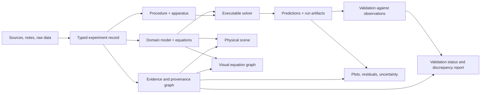

# Executable Experiments and Visual Mathematics Compression

- **Status:** Proposed architecture for review; the full architecture is not implemented or benchmarked by this document.

> **Implementation update (2026-10-19):** A first, deliberately narrow Rust package now exists at `crates/domains/symtropy-experiment-core`. It defines a typed arithmetic equation graph, checks operator arity and dimensions, catches duplicate outputs and dependency cycles, derives formula labels from executable operators, evaluates a synthetic gear-ratio fixture, and supports repeatable parameter/input overrides with deterministic one-variable sweeps. A separate analytical-reference harmonic-oscillator module compares explicit and symplectic Euler integration with exact position/velocity solutions, records energy drift, and includes a coarse-to-fine convergence report that estimates observed pairwise order. A renderer-neutral visual-math projection and `inspect` CLI mode export the same canonical IDs and generated formula labels to future visualization clients, even if an under-specified graph cannot yet run. Fifty-five Rust test functions are now authored across the arithmetic graph, visual projection, unit registry, oscillator, receipt provenance, and CLI receipt-verification modules, but **have not been executed** in the current environment. The arithmetic graph also validates registered unit/dimension pairs, converts through canonical base units, and returns values in their declared units; the initial registry is a fail-closed subset rather than full UCUM. CLI execution modes now attach schema `0.3.0` receipts with exact input-byte hashes and RFC 8785 JCS hashes for model/output/receipt payloads, plus build-time Cargo.lock/package-manifest digests, source revision when provided, compiler/host/target metadata, execution settings, and package/schema/unit versions. A fixed fixture is verified by authored Rust tests and a separate narrow Python standard-library oracle. Receipt schema `0.3.0` hashes model/output/receipt payloads via RFC 8785 JCS and includes build-input digests; all embedded build claims remain unauthenticated until tied to a signed builder attestation. Receipts are unsigned integrity aids, not proof of authorship or scientific validity. The `verify-receipt` CLI command checks a receipt against its saved output envelope and original input, independently reporting receipt, input, parsed-model, and output digest mismatches. A portable static known-answer fixture has precomputed input, model, output, and receipt digests generated independently with Python `hashlib`; its expected digests are checked by authored Rust tests. These are narrow reference models, not a general-purpose physical simulator; the gear and oscillator fixtures are synthetic, not historical or physical laboratory reproductions. Standards interoperability and the visual human-factors study remain proposed work.

- **Scope:** Symtropy / Bevy execution and visualization, humanity-history-core provenance, Symthaea-assisted research, and later Sol-Atlas context views.
- **Core thesis:** Represent an experiment once as an evidence-linked, typed, versioned model; expose it through physical, mathematical, procedural, and statistical views.
- **Non-goals:** A universal physics engine; treating a 3D animation as proof; claiming every historical experiment is recoverable; replacing equations or derivations with decorative glyphs.

## 1. The two questions

### Can we physically model all the experiments?

We can build a common system that *can represent* a very broad range of experiments, and we can progressively implement models where the evidence and domain methods permit it. We cannot honestly promise a complete faithful reconstruction of every experiment in history: many procedures, apparatuses, measurements, material properties, and boundary conditions were never recorded or have been lost. Some experiments depend on chaotic, quantum, biological, social, or multiscale phenomena where different model classes and approximations are required.

The scalable goal is therefore: **every experiment we ingest can be represented and inspected; experiments advance through explicit levels of executable and empirical support.** Missing knowledge is represented as unknown, bounded, disputed, or hypothetical—not filled with plausible-looking defaults.

### Can we visually compress mathematics?

Yes, if compression means *reducing the visual and cognitive cost of navigating mathematical structure*, rather than discarding information. A compact diagram should be a lossless entry point to exact equations, units, definitions, assumptions, and derivations. A symbolic simplification or numerical approximation must be marked as such and carry the conditions under which it is valid.

## 2. Architecture: one canonical experiment, multiple linked views

The experiment record is canonical and renderer-independent. Bevy/Symtropy renders views and hosts interactive manipulation, but it does not own the scientific meaning.

Proposed conceptual pipeline:



A selection in any view must resolve to the same semantic IDs. Selecting a gear should reveal its ratio equation, parameter bounds, source evidence, solver component, and validation checks. Selecting a term in the equation should highlight the geometry, field, apparatus, measurement, or causal edge it represents.

### 2.1 Proposed records

The names below are conceptual until reviewed against the existing workspace schema.

- **ExperimentSpec** — stable ID, version, question, hypotheses, discipline, procedure, chronology, provenance and rights.
- **ModelGraph** — typed state variables, parameters, constants, equations/operators, units, constraints, domain validity, approximation labels and solver requirements.
- **ApparatusGraph** — physical or logical components, geometry, materials, connections, instruments, controllable inputs and measured outputs.
- **ObservationSet** — original measurements, source locators, units, censoring/missingness, calibration, uncertainty, transformations and rights.
- **RunManifest** — model/code revision, solver and configuration, parameter values, initial/boundary conditions, environment, seeds, input hashes, output hashes, command, status and limitations.
- **ValidationRecord** — comparison target, preregistered acceptance rule, metric, uncertainty handling, residuals, independent-reference status, result, and failures.
- **VisualizationProjection** — references to canonical variables, equations, assets and results, plus chosen visual encodings. This is a view, not a separate authority.
- **AssumptionSet** — explicit assumptions, ranges, alternatives, source or rationale, and the predictions that depend on them.

Use SI units internally where appropriate, while preserving source-native units and conversion provenance. A dimensionally incompatible equation or connection should fail validation. Unknown values must not be silently converted to zero or an exact estimate.

### 2.2 A common interface, not a universal solver

Define stable interfaces around state, inputs, parameters, observations and run results. Use domain-specific backends for the actual science: rigid-body and gear kinematics; circuits; fluid flow; heat transfer; reaction kinetics; orbital mechanics; statistical inference; agent-based or ecological models; and other regimes as they are justified.

A shared graph and evidence contract makes these modules composable. It does **not** mean one numerical method is appropriate for all of them. Each backend must declare its validity domain, numerical method, conservation/invariant checks where applicable, convergence requirements, and known limitations.

Where two regimes interact, make the coupling explicit (for example, thermal expansion changing gear alignment, or fluid pressure affecting a mechanical valve). Do not hide an unvalidated cross-domain bridge inside a visually seamless scene.

## 3. Four levels of physicalization

Experiments should be useful at more than one fidelity level:

1. **Evidence map:** sources, apparatus, procedure, variables and result summaries; no unsupported physical claims.
2. **Equation model:** inspectable mathematical relationships, dimensions, constraints and analytic solutions where available.
3. **Executable digital twin:** a parameterized simulation with recorded runs, reproducible inputs and validation status.
4. **Physical or hardware-in-the-loop replication:** real materials, instruments, sensors or actuators, with calibration, safety controls and synchronized run data.

A fifth label, **counterfactual reconstruction**, can mark scenarios that ask what might have happened under alternative assumptions. Counterfactuals must not look identical to observed events in the interface.

A project may expose several levels at once: for example, exact measured geometry for surviving parts, a range of plausible geometry for damaged parts, and several competing models for missing components. Distinguish each component's epistemic status.

## 4. Visual math: compact without becoming lossy

Build a navigable mathematical visual language with four linked scales. Users can move from intuition to exact form and back without changing the underlying model.

### Level 1 — Physical intuition

Show the phenomenon: rotating gears, moving bodies, field lines, a pressure gradient, a reaction network, or a population flow. Use overlays for causal direction, forces, flux, transfer, constraints and changing state. Motion is only an explanatory view; it must not stand in for measured validation.

### Level 2 — Structural math

Represent equations as a typed operator graph, not a screenshot of typeset text. For example:

```text
input angle ──[gear ratio: -N₁/N₂]──> output angle
                                      │
                                      └──[phase offset]──> dial reading
```

The graph exposes operations, dependency direction, units, dimensions, assumptions and shared subexpressions. A single reusable model component should have one semantic identity even when shown in several scenes.

### Level 3 — Exact mathematical form

Clicking a node opens the actual expression, variable definitions, units, domain restrictions, source references and current parameter values. Keep an accessible textual/LaTeX representation and a machine-readable equation representation. The compact diagram supplements rather than replaces the exact form.

### Level 4 — Derivation, numerics and proof obligations

Let users inspect derivations, algebraic transformations, solver discretization, convergence evidence, uncertainty propagation, residuals and validation artifacts. Where transformations are formally checked, attach the proof or checker result and its assumptions. Otherwise label them as symbolic rewrite, numerical approximation, or human explanation rather than verified proof.

### 4.1 Rules for honest compression

- Every glyph, edge, color, animation and aggregate links to a semantic ID and a textual explanation.
- Visual simplifications preserve sign, direction, scale, dimensionality, uncertainty and causality. If an encoding cannot preserve a property, it must say so.
- Use different visual states for **exact identity**, **equivalent under conditions**, **approximation**, **hypothesis**, and **unknown**. Color may supplement labels but must not be the only encoding.
- Uncertainty belongs in the view: intervals, bands, ensembles, distributions or explicitly bounded regions—not just a confidence badge.
- Never hide variables or omitted terms merely to make a diagram cleaner. Collapsed subgraphs show the number and type of hidden components and allow expansion.
- Treat equation rewrites as transformations with preconditions. For example, cancellation can be invalid when a denominator may be zero; linearization is local to a stated operating point.
- Make views keyboard accessible, screen-reader navigable, and usable without animation. Respect reduced-motion settings and provide a static diagram and text equivalent.
- Keep unit conversion and rounding visible in detail panels; preserve the original value and its provenance.

### 4.2 Compress by reusing proven structure

The strongest compression may be compositional rather than graphical. Libraries of validated patterns—rigid rotation, gear ratio, oscillator, conservation balance, diffusion, reaction-rate law, state-space model, measurement noise, regression and Bayesian likelihood—let many models reuse the same mathematical structure.

A pattern should include its semantic contract, units, preconditions, tests, supported solver backends, provenance and known failure modes. Pattern reuse reduces duplicated code and explanation without pretending that different phenomena are identical.

## 5. Experiment workflow

1. **Capture:** ingest the procedure, source passages, diagrams, raw data and rights. Preserve the originals and provenance.
2. **Formalize:** define the question, alternatives, variables, units, equations, initial and boundary conditions, instruments and assumptions.
3. **Check:** validate schema, units, dimensional consistency, parameter ranges, dependency cycles, applicable invariants and required inputs.
4. **Preview:** produce a static schematic and equation graph before investing in high-fidelity assets.
5. **Execute:** run the relevant domain backend with a complete RunManifest and content-addressed inputs.
6. **Compare:** evaluate predictions against source-reported or independently measured results using predeclared metrics. Preserve failed and negative results.
7. **Stress-test:** vary uncertain parameters, compare alternative models, test boundary cases, ablations and negative controls, and record sensitivity.
8. **Publish:** expose the physical scene, equation graph, observations, residuals, evidence links, run recipe, assets/rights and limitations as one navigable unit.

AI-assisted extraction may propose variables, equations, or missing citations, but generated proposals remain unverified until reviewed. A successful schema check only proves structural validity, not that the source supports the claim or that the model is scientifically correct.

## 6. Initial vertical slice: Antikythera

This is a useful stress test because the surviving device connects mechanism design, astronomy, mathematical cycles, inscriptions, physical constraints and uncertain reconstruction. It should be split into separate experiments rather than treated as one undifferentiated 3D model:

- **Mechanical kinematics:** surviving and hypothesized gear trains, ratios, phase relationships, clearances, input/output rotations and dial readings.
- **Astronomical mapping:** the mathematical cycle and calendar model used to map time to displayed positions; assumptions and historical models remain explicit.
- **Reconstruction alternatives:** competing feasible mechanisms for missing components, with geometric constraints and evidence references.
- **Posterior replication:** a separate statistical experiment that reproduces the published count/probability estimates from their real data and code. It is not validated merely because the gears animate.

Start with the best documented mechanical subsystem. Preserve ranges for uncertain tooth geometry and multiple models for lost parts; compare observable dial behavior to reference constraints. Use the visual equation graph to show how changing a gear ratio shifts a pointer, then link any comparison to the exact source evidence.

The posterior-replication task remains gated on retrieving the actual dataset, verifying its license and contents, and hashing the real inputs. Source-reported posterior tables must not be relabeled as reproduced outputs.

Useful starting research:
- Efstathiou et al., “Determination of the gears geometrical parameters necessary for the construction of an operational model of the Antikythera Mechanism,” *Mechanism and Machine Theory* (2012): https://doi.org/10.1016/j.mechmachtheory.2012.01.020
- Yan and Lin, “Reconstruction synthesis of the lost interior mechanism for the solar anomaly motion of the Antikythera mechanism” (2013): https://doi.org/10.1016/j.mechmachtheory.2013.08.005
- Freeth et al., “A Model of the Cosmos in the ancient Greek Antikythera Mechanism,” *Scientific Reports* (2021): https://www.nature.com/articles/s41598-021-84310-w
- The London Charter on computer-based visualization of cultural heritage: https://www.london-charter.org/

These papers provide starting points and competing proposals, not automatic ground truth.

## 7. Benchmarks and release gates

Track quality as a vector of independently reportable measures, not a single composite score that lets a beautiful renderer offset a wrong model.

| Dimension | Proposed benchmark |
|---|---|
| Traceability | 100% of displayed variables and equation nodes resolve to definitions, units, provenance and semantic IDs. |
| Dimensional integrity | All intentionally invalid unit combinations in the test suite are rejected; zero silent conversions. |
| Reproducibility | Repeat a fixed run from the same content-addressed inputs; outputs must match exactly for deterministic solvers or fall within a declared numerical tolerance. |
| Empirical agreement | Pre-register error metrics and tolerances per experiment; report residuals and uncertainty, including failed runs. No global tolerance masquerading as universal science. |
| Calibration | Where statistical predictions are made, evaluate coverage/calibration on suitable synthetic and held-out cases rather than only fitting source data. |
| Sensitivity | Identify which inputs materially move outputs; compare local sensitivities with finite-difference or other independent checks where appropriate. |
| Numerical integrity | Test convergence, stability, boundary behavior and domain-specific invariants for the solver in use. |
| Visual comprehension | Compare task accuracy and time-to-answer against an equation-only baseline; include misconceptions and accessibility, not just preference surveys. |
| Compression quality | Measure screen/interaction cost against information loss: hidden dependencies, units, assumptions and uncertainty must remain recoverable. |
| Provenance | Every published run names code/model revision, environment, parameter and input manifest, command, output hashes and limitations. |
| Physical fidelity | When hardware exists, report instrument calibration, repeatability, uncertainty budget and sim-to-real discrepancy. |

Release gates should be staged: structural validity; mathematical and unit checks; numerical tests; comparison against independent references; physical validation when possible. Failed gates remain visible. Never weaken thresholds after seeing results without creating a new, explicitly justified protocol.

For visual compression, a particularly useful test is: **can a researcher trace an observed discrepancy from measurement → plot/residual → output variable → equation term → parameter/assumption → source and run, without losing exact values?** The system should make this path shorter, not remove steps that matter.

## 8. Implementation phases

**Phase 1 — contract and fixtures:** review ExperimentSpec/ModelGraph/RunManifest/ValidationRecord schemas; add synthetic toy experiments with known answers (gear train, oscillator, dimensional-analysis failure, simple reaction model). Verify the data contract and the visual-link mapping independently of high-fidelity rendering.

**Phase 2 — one end-to-end model:** render a documented Antikythera gear subsystem with an equation graph, linked parameters, uncertainty overlays, and a run manifest. Use static and interactive views of the same canonical IDs.

**Phase 3 — comparison and sensitivity:** add reference measurements, residual/uncertainty views, alternative reconstruction models, parameter sweeps, and explicit pass/fail criteria.

**Phase 4 — cross-domain adapters:** add other experiment backends only where a domain-specific test suite and reference data are available. Reuse the record and visualization contracts, not an unjustified universal solver.

**Phase 5 — physical replication:** connect real sensors/instruments and calibration records where access permits. Treat a build, its measured outputs, and the digital model as related but distinct artifacts.

## 9. Decisions for review

1. Approve a renderer-independent experiment and equation contract before tying the ontology to Bevy components.
2. Require every visual encoding to be traceable and every compression step to distinguish exactness from approximation.
3. Keep physics-domain solvers separate behind explicit interfaces and validity claims.
4. Start with synthetic known-answer tests, then one carefully sourced Antikythera subsystem.
5. Count verified, executable and physically replicated experiments separately; do not optimize for the raw number of scenes.

Run-receipt schema, verification limits, external provenance standards, and reproducibility benchmarks are specified in [EXPERIMENT_RUN_RECEIPTS_AND_REPRODUCIBILITY.md](EXPERIMENT_RUN_RECEIPTS_AND_REPRODUCIBILITY.md).

The target is not a museum of impressive animations. It is a growing, inspectable laboratory for humanity's experiments: see the apparatus, understand the compact structure, expand to the full mathematics, execute the model, compare it with evidence, and discover exactly where current knowledge stops.
