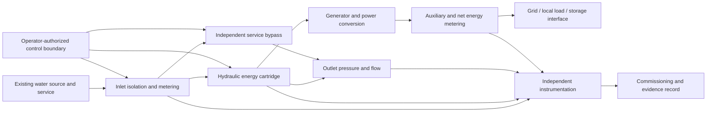

# PAT Energy-Recovery Cassette — Product Requirements v0.1

**Status:** research / concept definition. Not a site design, production drawing, pressure-boundary specification or approved engineering package.

**Owner:** Symtropy. Related work: PAT-ENERGY-CASSETTE-DFMA-001 #4420; HYDRO-CONDUIT-TWIN-001 #4386; WDN-PAT-COOPT-001 #4397; HYDRO-COMPONENT-UNCERTAINTY-001 #4401; Sol-Atlas SA-CONDUIT-HYDRO-001 #675 and ENERGY-GEN-PORTFOLIO-001 #293.

## 1. Product thesis

A water-energy recovery unit should be engineered as a **service-preserving, replaceable, testable product platform** rather than a custom turbine bolted into an existing pipe.

The product boundary includes the hydraulic machine, bypass/service path, electrical conversion, instrumentation, controls interface, skid/spools, maintainability provisions and commissioning evidence. A turbine-only efficiency number is not a product performance result.

A product family should allow a site to select a configuration from a declared, evidence-backed operating envelope. It must not make missing site data look like a valid selection.

## 2. Product family — deliberately distinct configurations

| Configuration | Intended duty | Product boundary | Non-goal |
|---|---|---|---|
| U-PAT | Unidirectional flow and pressure energy recovery | Turbine-mode PAT cartridge, bypass spool, generator/converter, measurement, skid and service interfaces | Treating pump-mode curve estimates as turbine-mode evidence |
| B-PAT | Reversible pump / turbine station | Pump-mode and turbine-mode machine maps, drive, valves, bypass, grid import/export metering and mode-state record | Counting pumped energy as recovered generation or hiding round-trip losses |
| LHT | Purpose-built low-head turbine | Its own hydraulic map, wetted materials, generator, bypass and acceptance package | Assuming a PAT map or generic low-head efficiency applies |

U-PAT and B-PAT are not one interchangeable configuration. B-PAT requires independently supported pump and turbine modes, mode transition logic, protection boundaries and net import/export accounting. LHT is a different machine family, admitted only by measured comparative evidence.

## 3. Functional architecture

This is a conceptual boundary diagram only. It does not prescribe valve fail position, pressure rating, protection setting, control topology or detailed pipework. Those are site-specific engineering decisions.

## 4. Interfaces to freeze before detailed design

Each interface definition must have a stable ID and revision, owner, measurable acceptance criteria, evidence source and prohibited assumptions.

### 4.1 Hydraulic interface

- inlet/outlet connection type, nominal size and allowable tolerances;
- operating pressure and temperature envelope;
- measured upstream, machine-branch and bypass flow;
- gross head, conveyance loss and net head definitions;
- water chemistry, solids, suspended matter, fouling and biofilm envelope;
- permitted pressure drop and operating point range;
- transient pressure, water-hammer, cavitation and structural limits supplied by qualified specialist analysis;
- water-quality, leakage, flushing, drainage and isolation requirements.

The Symtropy hydraulic reference (#4386) supplies an analytical steady-state component ledger and exact map-domain checks. It does not qualify transients or pressure-boundary construction.

### 4.2 Electrical interface

- generator output type, voltage/frequency and operating envelope;
- power-electronics operating map, protection and fault-current limits;
- auxiliary loads and standby consumption;
- net AC/DC energy measurement boundary;
- grid/PCC, local-load or storage interface owner;
- import/export register direction, clock synchronization and meter calibration;
- cybersecurity, network segmentation and OT authorization.

### 4.3 Mechanical / service interface

- support loads and installation envelope;
- lifting points, lifting mass and clearances;
- cartridge extraction and replacement space;
- bearing, seal and wear-part access;
- inspection, cleaning, flushing and drainage access;
- vibration, noise, temperature and alignment acceptance;
- materials compatibility and corrosion protection;
- shipping, storage and site handling constraints.

## 5. Product architecture and modularity hypotheses

The following are design hypotheses to test against lifecycle cost and reliability—not predetermined design solutions.

1. **Replaceable wetted cartridge:** separate the machine's wear/precision hydraulic assembly from the installed spool/skid where practicable.
2. **Standardized measurement spool:** preserve known meter locations and pressure taps so each unit is testable and comparable.
3. **Independent service bypass:** keep pre-existing water delivery capability independent of turbine generation. It must be sized and approved for the site, not inferred from a generic product template.
4. **Electrical conversion as a separate revisioned module:** do not bake generator, inverter and auxiliary-load losses into an undocumented turbine efficiency.
5. **Serviceable instrumentation:** meters and sensors must be replaceable and calibration-referenced without requiring a turbine redesign.
6. **Configuration-controlled interfaces:** every physical/electrical connector, firmware/software version and map revision must be bound to a build configuration.
7. **Repair-first lifecycle:** design for inspection, replaceable seals/bearings, cartridge repair, remanufacture and controlled materials recovery.

A modular design is not automatically cheaper or more reliable. Compare interface count, leakage paths, seals, fasteners, alignment, inventory, assembly time and field failure modes against a one-off welded or cast package.

## 6. Design-for-manufacture and assembly study

For each candidate configuration, report the following rather than making a vague “easy to manufacture” claim:

- total and unique part count;
- bespoke vs catalogue parts and source/lead-time evidence;
- machining, casting, forming, welding, heat-treatment and balancing operations;
- tolerance stack and critical-to-quality dimensions;
- inspection/measurement operations and required gauges;
- assembly touch time and tool changes;
- pressure-boundary and electrical inspection hold points;
- nonconformances, repair and scrap;
- shipping volume, lifting mass and site access envelope;
- cartridge change-out procedure, time, crew and lifting equipment;
- spare parts and consumable requirements;
- material traceability, repairability and end-of-life route.

A local supplier capability assertion is not supplier qualification. Supplier claims, certificates, audit, receiving inspection and in-service performance remain distinct evidence.

## 7. Qualification and factory acceptance test concept

The test rig should independently meter upstream supply, machine branch and bypass; inlet/outlet pressure; water temperature; shaft speed/torque where accessible; gross electrical output; auxiliary load; and net export/import.

### Test families

1. **Baseline/service-only:** bypass operation with no generation. Demonstrate service continuity and zero credited generation.
2. **Map sweep:** controlled head/flow operating points inside the declared map; record uncertainty and repeatability.
3. **Part-load and minimum stable flow:** do not infer stable performance from BEP alone.
4. **Bypass and transition:** controlled transitions with service and mode records.
5. **Electrical load variation:** generator/converter losses, auxiliary loads, net power and power-quality boundary.
6. **Repeated duty cycles:** thermal, vibration, starts/stops and drift.
7. **Water-quality exposure:** only the solids/chemistry envelope appropriate to the intended site; record cleaning and fouling.
8. **Inspection / serviceability:** cartridge extraction, seal/bearing inspection, reassembly and repeat test.

Transient safety, water hammer, cavitation erosion, fatigue, structural integrity, electrical protection and water-contact approval require separate qualified test methods and independent acceptance. Passing this steady-state map test cannot stand in for those gates.

### Minimum factory acceptance evidence

- exact build/configuration identity and BOM revision;
- material and supplier certificates, where required;
- manufacturing/inspection records;
- pressure-boundary test evidence by qualified method;
- measured map and uncertainty;
- electrical conversion and auxiliary-load tests;
- calibrated measurement chain and timebase;
- safety and exclusion list;
- unresolved defects, concessions and signed acceptance scope.

## 8. Site installation and commissioning acceptance

The installation process must preserve service first. A site-specific installation method statement, hazard analysis, water-use approval, electrical approval, permits, operator switching plan and independent inspection are prerequisites outside the authority of this research module.

The acceptance record should separate:
- as-designed configuration;
- as-manufactured configuration;
- as-installed configuration;
- as-commissioned configuration.

Record actual outage duration, temporary works, tie-in time, labour and crew hours, first-pass acceptance, rework, leak/pressure findings, service availability, flow split, energy balance, net electrical output, bypass share, protection checks and metering calibration.

A commissioning report should have an explicit indeterminate state when meters, clocks, map domain, service limits or approvals are missing.

## 9. Benchmark scorecard

Do not collapse performance into one scalar. Preserve this vector:

| Dimension | Required output | Proposed development target (not achieved) |
|---|---|---|
| Service preservation | pressure/flow floors, service interruptions, recovery | zero hard service violations in frozen acceptance corpus |
| Map quality | held-out measured vs predicted hydraulic/electrical output | error within independently measured map/test uncertainty |
| Net energy | net kWh, auxiliary kWh, export/import, bypass fraction | improvement over matched PRV and static-PAT cases without service regression |
| Manufacturing | unique parts, bespoke operations, assembly hours, rework | >=30% fewer assembly touch-hours vs documented one-off baseline |
| Installation | site labour and planned service outage | <= one work shift for a qualified standard configuration, excluding site-mandated windows |
| Repairability | cartridge removal/replacement, tools, crew, access | <=4 hours for a qualified cartridge replacement with declared crew and lifting arrangement |
| Reliability | availability, failures, MTTR, wear, seal/bearing life | establish a measured duty-cycle baseline before setting warranty-grade targets |
| Lifecycle | net LCOE, maintenance, water/material/embodied impacts | report full boundary and Pareto trade-offs, no hidden externalities |

The one-shift, four-hour and 30% targets are product-development hypotheses. They must be compared against an observed one-off baseline before being promoted into requirements or commercial claims.

## 10. South African evidence boundary

Leliefontein / Drakenstein is a valuable local bidirectional PAT product comparator. The 2021 IMESA paper describes operation since 2018, SCADA and bidirectional power metering. It estimates 320 MWh/year and 9.9 GWh over the stated lifetime, but also contains cumulative figures of 271,236 MWh generated and 53,577 MWh consumed that are inconsistent with those estimates. Those cumulative values stay unresolved and must not be used as MWh until the municipality or authors confirms the units and the original interval registers.

The product family must not use this source as an independently audited efficiency or availability time series until raw operator meter/SCADA exports, sampling interval, meter calibration, pump/generation mode chronology and auxiliary consumption are obtained.

International PAT maps and full-scale installation papers are comparators, not South African transfer validation. The product's first customer and product configuration must be selected from measured operator site data, not a national atlas potential value.

## 11. Claim ceiling and next gate

This document is an early product requirements and testability contract. It is not a manufacturable design, certified pressure system, grid-connected package, approved controller, environmental authorization or bankable project.

The next gate is a configuration-controlled reference product definition with:
- two distinct product variants (unidirectional PAT and bidirectional pump/PAT);
- a functional breakdown and preliminary BOM;
- hydraulic/electrical/mechanical interface-control records;
- a matched DFM/DFA comparison;
- a qualification-rig measurement plan;
- factory/site acceptance records and open evidence gaps.

Detailed design or physical manufacture proceeds only after site requirements, licensed engineering, hazard studies, pressure/electrical approvals, independent inspection and operator authorization.
