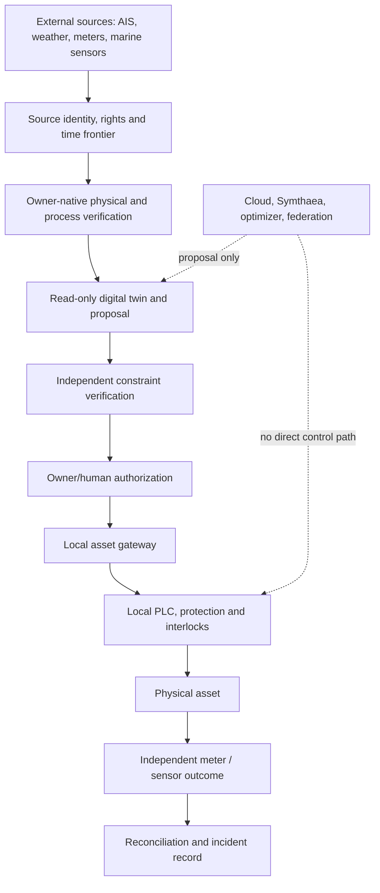

# Port Nexus Cyber-Physical Trust Benchmark v0.1

**Issue:** PORT-NEXUS-CYBER-RESILIENCE-001 (#6275)  
**Snapshot:** 19 November 2026  
**Status:** synthetic, offline red-team contract; no live OT integration.

## Objective

Qualify whether the Port Nexus digital twin preserves safe control authority and evidence integrity under malicious, faulty, stale, conflicting and unavailable data.

The environment spans port calls and AIS, berth/shore power, cranes and terminal operations, PCC/feeder meters, renewable generation, BESS, data-centre compute, liquid cooling, thermal stores, water treatment, marine sensors, fibre/cable routes and the four-owner decision/evidence plane.

The benchmark composes existing owner systems; it does not create another firewall, IAM system, control plane, SIEM, OT safety controller or dependency graph.

## 2026 standards and research frontier

### Maritime cyber risk

The IMO currently lists MSC-FAL.1/Circ.3/Rev.4 as the latest Guidelines on Maritime Cyber Risk Management. It reinforces the goal of shipping that is safe, secure and operationally resilient to cyber risk. Resolution MSC.428(98) continues to require cyber risk to be addressed within Safety Management Systems. The Rev.4 guidance includes the IAPH Cyber Resilience Guidelines for Emerging Technologies in the Maritime Supply Chain among referenced guidance. <https://www.imo.org/en/ourwork/security/pages/cyber-security.aspx>

The IMO's March 2026 Facilitation Committee approved a maritime digitalization strategy and cybersecurity measures for Maritime Single Windows. Proposed FAL Convention amendments were to be submitted for adoption in 2027 and are expected to enter into force in 2029; these future proposals are not current binding requirements. <https://www.imo.org/en/mediacentre/pressbriefings/pages/facilitation-committee-approves-digitalization-strategy-cyber-security-measures.aspx>

### OT security

NIST SP 800-82 Rev.4 Initial Public Draft was published 21 September 2026; comments are due 30 November 2026. The draft adds explicit maritime vessels, water/wastewater, building automation, freight rail, IIoT and cloud-convergence scope, and restructures around NIST CSF 2.0. SP 800-82 Rev.3 (September 2023) remains the finalized reference until Rev.4 is issued. <https://csrc.nist.gov/pubs/sp/800/82/r4/ipd>

### Submarine cable infrastructure

The European Commission's February 2026 Submarine Cable Security Toolbox addresses prevention, detection, response/recovery and deterrence for data and power cables. It is a useful resilience design reference, not South African law. <https://digital-strategy.ec.europa.eu/en/library/submarine-cable-security-toolbox-and-cable-projects-european-interest>

### Smart-port cyber research

Zhao et al., *Cybersecurity in smart port systems: A systematic review and data-driven research agenda*, Transport Policy 187 (October 2026), DOI 10.1016/j.tranpol.2026.104268, analyses smart-port attack scenarios and Maritime Cyber Attack Database evidence and identifies cyber-physical vulnerabilities, human factors and AI-related threats as active research challenges. <https://doi.org/10.1016/j.tranpol.2026.104268>

## Paradigm: qualify trust transitions, not component checklists

A valid signature does not establish freshness, calibration, physical plausibility, applicability or authority. A feasible schedule is not a command authorization. A delivered command is not evidence of physical effect.

Keep these claims separate:

1. **Source authenticity and rights:** who issued the data, what artifact/version it is and what uses are permitted.
2. **Observation integrity and time:** observation/event time, first-available time, sequence, freshness, digest and source revision.
3. **Physical plausibility and applicability:** sensor calibration, units, meter boundary, geometry, plausible range, model regime and evidence applicability.
4. **Proposal feasibility:** exact proposed schedule passes independent owner-native constraints.
5. **Authorization:** exact principal/role, asset, purpose, time window, limits, policy and revision are owner-authorized.
6. **Command delivery:** the exact message reached a named interface; this is not proof of actuation.
7. **Physical outcome:** independent measurement demonstrates delivered power/work/heat/water at a named boundary.
8. **Reconciliation:** duplicates, timeouts, partial effects and unknown outcomes are reconciled without silent overwrite.

## Trust-boundary reference

The local protection/interlock path must not depend on cloud, an optimizer, federation, LLM availability or an external identity provider to remain safe.

## Required invariants

- No direct cloud/LLM/Symthaea/optimizer-to-PLC, relay, inverter, pump, valve, ship switchboard, crane motion or water-treatment actuation.
- Local protection, emergency shutdown, safe state and operator control remain independent and deterministic.
- Loss of cloud/federation/time/identity/telemetry/network cannot increase authority.
- Stale, unauthenticated, conflicting, revoked, out-of-domain or future-available evidence remains Unknown/DataIncomplete.
- Hard electrical, thermal, water-quality and equipment limits remain non-compensatory.
- Proposal, authorization, command, acknowledgement and physical observation are distinct event types.
- Unknown actuator outcome means no new mutation until reconciliation.
- Valid signature is not proof of calibration, physical correctness, source independence or authority.
- All testing remains offline and synthetic until separately authorized safety cases and isolated OT labs exist.

## Owner boundaries

- Symtropy #4582/#6211/#6228/#6255/#6258/#3400/#3418/#6209: operational/PCC/workload/cooling/forecast feasibility and read-only replanning.
- Mycelix #5974/#5762: owner authority, provenance, common-cause identity, idempotency and reconciliation.
- Sol-Atlas #654/#942/#948: spatial, marine, water, cable, source-rights and environment evidence.
- Symthaea #5199/#11572/#11473: candidate proposal, uncertainty, inconsistency detection and abstention; no self-certification.

## Red-team corpus

The companion JSON fixture freezes 36 cases: positive controls, negative controls, unknown/incomplete states and conflict cases. It covers AIS replay/plausibility, meter sign and CT ratio changes, time skew, future forecast leakage, marine source applicability, BESS/thermal state conservation, fabricated water sinks, missing water quality, common-cause sensor dependencies, shared cable landings, evidence-category errors, compromised optimizers, unauthorized/revoked actors, asset binding, idempotency, timeouts/unknown effects, physical outcomes, identity service partitions, clock spoofing, revoked models/policies, OT segmentation, cloud outage, grid/fibre outage, least privilege, local interlocks, expired calibration and historical reconstruction.

## Metrics

Hard gates (synthetic test targets):
- unauthorized command success: zero;
- hard-boundary violation accepted: zero;
- stale/future/revoked evidence promoted to current: zero;
- replayed event causing duplicate logical effects: zero;
- authority expansion during partition: zero;
- false cable-route independence: zero;
- common-cause sensor failure falsely treated as independent: zero.

Report also:
- positive-control coverage and rejection/abstention rates;
- false reject and operator-review burden;
- detection/isolation and recovery time;
- command-to-physical-outcome reconciliation time;
- system latency and cryptographic/attestation overhead;
- deterministic historical replay agreement.

An all-rejecting system fails positive controls. Unknown/abstain and safe-degrade are explicit outcomes, not failures hidden as zeroes.

## First implementation sequence

1. Freeze the 36-case offline JSON red-team corpus.
2. Bind each case to owner-native source/config/digest and time-frontier references.
3. Add attack trees and trust-boundary traces; reuse #5974/#5762 rather than a new identity or dependency engine.
4. Compose with the shared-PCC, heat-sink, compute and marine golden traces.
5. Only after isolated testing and authority review consider hardware-in-the-loop integration.

## Claim ceiling

This benchmark qualifies synthetic cyber-physical trust transitions and safe-degraded dispositions only. It is not an OT penetration test, IEC 62443 certification, NIST compliance claim, maritime SMS approval, grid-code qualification, live-port assessment or authorization to connect to control networks.
