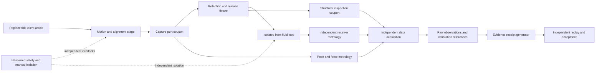

# Orbital Service Ground Test Cell v0.1

**Status:** design specification / proposal. No hardware is asserted to have been procured or tested.  
**Owner:** [ORBITAL-SERVICE-GROUND-TEST-CELL-001](https://github.com/Luminous-Dynamics/symtropy/issues/6256)  
**Composes with:** [service acceptance #3257](https://github.com/Luminous-Dynamics/symtropy/issues/3257), [service corpus #3258](https://github.com/Luminous-Dynamics/symtropy/issues/3258), [Earth-to-orbit #3252](https://github.com/Luminous-Dynamics/symtropy/pull/3252), [capture handoff #12903](https://github.com/Luminous-Dynamics/symthaea/pull/12903), [fluid transfer #6182](https://github.com/Luminous-Dynamics/symtropy/pull/6182), [receipt composition #6221](https://github.com/Luminous-Dynamics/symtropy/pull/6221), and [structural acceptance #4263](https://github.com/Luminous-Dynamics/symtropy/issues/4263).

## 1. Purpose and claim boundary

Build an uncrewed, instrumented, terrestrial test cell that physically exercises one small servicing interface through:

`configured article → approach/alignment → contact → capture → retention → service connection → inert-fluid transfer → receiver acceptance → isolation/disconnect → independent inspection`

The test cell addresses a specific gap between disconnected demonstrations: an end-to-end service cycle with independent measurements and reproducible evidence at every handoff.

**V0 is a guarded ground bench using inert benign liquids only.** Begin with an unpressurized or otherwise low-stored-energy water loop. A different fluid, any gas loop, or any stored-energy system requires a separate documented hazard review and equipment-specific approval. Do not use hydrazine, hypergolic propellants, liquid oxygen, cryogens, flight tanks, live spacecraft hardware, or an improvised pressure vessel.

This design is not a spacecraft, flight interface standard, pressure-vessel design, capture controller, cryogenic transfer system, or mission procedure. Passing a test qualifies only the exact fixture, instrument set, fluid, configuration, procedure, load and environment tested.

## 2. Design principles

1. **Inspectability is designed in.** Put datums, fiducials, inspection access, replaceable coupons, service clearances and sensor locations into the interface from the beginning.
2. **Capture is not fluid connection.** Prove contact, latch, retention, mating and fluid-loop continuity as separate states.
3. **Measure the receiver, not just the source.** Independently quantify source loss, receiver gain, residual, rejected fluid, catch/vent and leak.
4. **Safety is physically independent of the software stack.** A hardwired emergency stop, manual isolation and containment remain effective if the computer, network or evidence pipeline fails.
5. **Record every trial.** Aborts, retries, leaks, jams, indeterminate measurements and failed inspections remain in the data set.
6. **Use typed, evidence-carrying interfaces.** Symthaea may propose/interpret; Symtropy evaluates/replays; the independent safety system owns interlocks; Mycelix may preserve provenance. None of the software systems commands hazardous actuation or certifies physical truth.
7. **No scalar readiness score.** Mechanical performance, fluid quality, structural acceptance, safety, repeatability, cost and cycle time remain separate results.

## 3. System architecture

The diagram is a logical boundary, not a finished wiring or piping diagram.

### 3.0 Reuse existing measurement and acceptance owners

Do not add a second generic metrology or uncertainty engine. Compose these existing workstreams:
- [#3987 METROLOGY-ARCH-001](https://github.com/Luminous-Dynamics/symtropy/issues/3987) for traceable physical measurement-system architecture and qualification-record structure.
- [#5894 KITCHEN-METROLOGY-001](https://github.com/Luminous-Dynamics/symtropy/issues/5894) as a practical pre-trial checklist for instrument selection, calibration scope and frozen measurement procedures; reuse the pattern, not its kitchen-specific measurands.
- [#6266 ACTUATOR-METROLOGY-SYNCHRONIZATION-001](https://github.com/Luminous-Dynamics/symtropy/issues/6266) for synchronized torque/power channels, time-base offsets, delay and dynamic measurement uncertainty.
- [#5062 LOCO-MEASUREMENT-UQ-RECEIPT-001](https://github.com/Luminous-Dynamics/symtropy/issues/5062) for dependency/correlation-preserving uncertainty evidence; the ground-cell adapter consumes its output rather than recomputing covariance.
- [#6140 SYNTH-JOINT-BENCHMARK-CONTRACT-001](https://github.com/Luminous-Dynamics/symtropy/issues/6140) for multidimensional, evidence-bound comparison records and non-composite scorecards.
- [#4263 ORBITAL-TRUSS-ACCEPTANCE-001](https://github.com/Luminous-Dynamics/symtropy/issues/4263) for as-built geometry, joint inspection and structural response acceptance.

The ground-cell issue owns the system integration, test plan, safety review, selected instrument configuration and physical evidence handoff. The measurement owners remain authoritative for their respective calibration, synchronization, uncertainty and structural calculations.

### 3.1 Mechanical base and client fixture

A rigid, guarded base supports:
- a replaceable mock client article with a unique serial and configuration revision;
- a replaceable service-port coupon with its own ID and interface revision;
- a declared datum frame and accessible metrology fiducials;
- configurable alignment offsets and angular misalignment;
- a compliant or instrumented contact mount;
- a load path that permits retention tests without using the motion stage as the only measurement reference;
- mechanical stops and containment/guarding appropriate to the selected hardware.

The first article should be a simple, accessible geometry rather than a flight-like satellite mock-up. The purpose is to qualify the test method and evidence chain before adding geometric complexity.

### 3.2 Motion, contact and capture fixture

Use a configurable low-speed translation/rotation stage or laboratory manipulator with:
- repeatable approach-axis motion;
- controlled lateral and angular misalignment;
- calibrated pose measurement independent of motor-step counts;
- force/torque measurement at or near the contact interface;
- replaceable compliant contact elements;
- a mechanical capture/latch coupon with independent engaged/disengaged witness;
- a separate retention-load path and release/disconnect mechanism.

Do not infer contact from commanded position, latch engagement from a software flag, or retention from a successful approach trajectory. The capture measurement chain must independently observe each state.

### 3.3 Service-port coupon

The coupon is the central interoperability object. Its controlled configuration should contain:
- article serial and interface ID/revision;
- primary datum and fiducial coordinates;
- mechanical engagement and alignment features;
- latch/retention witness locations;
- fluid connector and replaceable seal elements appropriate to the benign test loop;
- inspection surfaces and access clearances;
- material and cleanliness records;
- allowable use and test envelope supplied by the responsible design authority.

Every coupon change increments the configuration revision. A changed coupon must not silently inherit evidence from a prior revision.

### 3.4 Inert-fluid loop

The initial fluid loop should be a physically separate, closed, contained and low-stored-energy subsystem:
- identified source vessel and receiving vessel;
- separately calibrated source and receiver mass measurement;
- a flow measurement channel as a diagnostic, not the sole mass-acceptance basis;
- temperature and pressure sensors appropriate to the approved loop;
- manual isolation and independently controlled valves;
- leak/catch/secondary-containment observation;
- drain, clean and reset procedure;
- fluid identity, batch and cleanliness record.

The loop must be isolated from the motion/capture actuator's authority. A capture pass must not automatically open a fluid valve. A fluid-transfer pass must not automatically authorize disconnect or another physical operation.

No generic pressure, flow, relief or test-load value is specified here. Those limits must come from the selected components, their documentation, a documented hazard analysis and approval by a qualified responsible engineer.

### 3.5 Structural inspection coupon

Use a small modular truss or joint coupon only after the dry-capture and inert-fluid stages are independently accepted. Include:
- serialized members and joints;
- as-built dimensional survey;
- inspectable joint features;
- a reviewed and bounded load fixture;
- independent displacement/strain measurement;
- a declared analytical reference or qualified external model where applicable.

A successful robotic connection is not structural acceptance. The inspection result must identify what was inspected, the measurement coverage, uncertainty, applied load and residual between measured and predicted behaviour.

### 3.6 Safety and independent control plane

The safety plane must not depend on Symthaea, Symtropy, Mycelix, the receipt generator, a network connection or a cloud service. It includes, as appropriate to the selected equipment:
- hardwired emergency stop;
- manual fluid isolation;
- power isolation;
- mechanical guarding and access control;
- secondary containment;
- reviewed stored-energy and electrical hazards;
- equipment-specific relief/protection;
- approved startup, shutdown, drain and maintenance procedures.

The test cell must fail safe on loss of power, communications, control software, sensor validity or operator supervision. A software receipt cannot override a physical interlock.

## 4. Instrumentation and metrology

All channels must declare instrument ID/serial, calibration certificate, calibration status/validity, range, resolution, uncertainty, sample rate, clock/time base, units, mounting location and data path. Use #3987/#5894 for instrument and calibration completeness, #6266 for dynamic-channel synchronization, and #5062 for uncertainty dependence; this document defines no replacement record schema.

| Measurement | Primary method | Independent cross-check |
|---|---|---|
| Article and coupon identity | serialized configuration record | physical label/marking and photo |
| Relative pose | optical metrology / calibrated fiducials | independent survey or second sensor path |
| Contact force/torque | calibrated force/torque sensor | fixture reaction or reference load check |
| Latch state | direct mechanical/electrical witness | independent video or position channel |
| Retention | instrumented load path | independent displacement/strain measurement |
| Source/receiver mass | calibrated balances | transfer meter as diagnostic |
| Fluid temperature/pressure | calibrated sensors | independent reference check where justified |
| Leak/catch | containment and leak observation | mass-balance residual and post-test inspection |
| Structural geometry | dimensional metrology | independent survey of selected datums |
| Structural response | load plus displacement/strain | independent load/reaction check |

A hash binds the bytes of a calibration certificate; it does not establish that the certificate is valid for the instrument, range, date or test setup. The independent verifier must check calibration scope, validity, range, uncertainty and traceability.

### 4.1 Time and event identity

Use one declared monotonic acquisition clock for test events. If instruments have separate clocks, record the synchronization method, offset estimate and uncertainty. Never silently compare timestamps from unrelated clock domains.

Every event binds:
- campaign/run ID;
- article, coupon, instrument and procedure revisions;
- event ID and parent event ID;
- stage, state and measured transition;
- sensor channels and raw-data artifact IDs;
- calibration references;
- operator/witness and independent verifier;
- result and reason codes.

## 5. Test sequence and gates

### P0 — design and safety review

Freeze the system block diagram, fixture drawing, selected equipment, fluid choice, hazard analysis, instrument list, measurement ranges, calibration plan, test procedures, stop criteria and responsible approvals. P0 is not permission to buy or operate equipment.

**Exit:** reviewed test plan, safe equipment limits, approved measurement configuration, complete hazard controls and pre-registered test matrix.

### P1 — dry alignment and capture

Test alignment, approach, contact, latch, retention, release and disconnect without fluid. Begin with guarded low-energy motion and a replaceable interface coupon.

Include nominal runs and pre-registered negative controls: wrong article, wrong coupon revision, frame/datum error, lateral/angle misalignment, aborted approach, excessive contact load, incomplete latch, failed retention witness, stale calibration and unavailable metrology.

**Exit:** independent pose/force/retention evidence; all hard-negative controls rejected or indeterminate as specified; no false acceptance; repeated trials with every abort preserved.

### P2 — inert-fluid transfer

Only after P1 acceptance, connect the separate benign-fluid loop. Test continuity, leak checks, controlled transfer, source/receiver measurement, fluid-state acceptance, isolation and disconnect.

The mass balance is:

`source_decrease = receiver_accepted + receiver_rejected + line_residual + catch/vent + leak + unexplained_residual`

The unexplained residual must be reported and assessed against a pre-declared combined measurement uncertainty. It must never be silently assigned to the receiver or rounded away.

**Exit:** exact accounting within pre-registered metrology tolerance; receiver acceptance based on receiver evidence; all leak, missing-meter, wrong-fluid, wrong-interface and out-of-envelope controls rejected or indeterminate.

### P3 — structural inspection coupon

Assemble or reconfigure a small truss/joint coupon. Independently survey as-built geometry, inspect critical interfaces, apply a reviewed bounded test load and compare response to an analytic or qualified external model only inside that model's context of use.

**Exit:** as-built deviations, inspection coverage, load, displacement/strain, reactions, uncertainty and model residual are recorded. Critical-defect negative controls are not accepted.

### P4 — integrated ground service cycle

Run the complete sequence using one serialized article and coupon configuration. Generate separate delivery/configuration, capture, fluid and structural records, then compose them with the service acceptance tool. The integrated bundle must point back to the exact raw observations, input fixtures, calibration records and source receipts.

**Exit:** independent replay reproduces the event sequence, identities, mass balance and dispositions from raw input files; all seven-file composition hashes reproduce; no accepted stage is inferred from another stage's pass.

### P5 — environment and flight pathway (separate decision)

Only after P4, create a separate gap assessment for vacuum, thermal cycling, materials compatibility, contamination, vibration, radiation, microgravity contact dynamics, fault tolerance and mission-specific operations. This document does not authorize or automatically initiate this phase.

## 6. Pre-registered benchmark matrix

The benchmark records raw counts and denominators; do not report only a success percentage.

| Family | Positive control | Adversarial controls | Primary metric |
|---|---|---|---|
| Identity/configuration | correct article + coupon revision | wrong client, duplicate serial, stale revision | exact identity continuity |
| Alignment/contact | within declared capture envelope | datum error, misalignment, aborted approach, force limit | pose error, contact impulse, peak force/torque |
| Capture/retention | latch and independent retention witness pass | latch flag without engagement, retention not run/fails | false accepts, retention margin, release outcome |
| Fluid connection | correct loop, correct receiver, complete evidence | leak, wrong fluid, wrong receiver, missing meter, isolation failure | accepted mass, residual, leak/catch, receiver state |
| Accounting | source/receiver/residual streams reconcile | double count, hidden residual, stale balance, unit mismatch | mass-balance residual against uncertainty |
| Inspection | known conforming coupon | seeded dimensional/joint defects, missing coverage | detection and false-accept rates |
| Evidence replay | exact input/output and calibration bundle | stale hash, stale code pin, missing raw data, claim mismatch | byte reproducibility and disposition agreement |

### 6.1 Acceptance targets (proposed, not achieved)

- 100% exact client, coupon/interface revision and receiver identity continuity for accepted runs.
- Zero false accepts on the frozen hard-negative matrix.
- 100% expected-result agreement on the frozen reference corpus.
- 100% of accepted measurements reference valid calibration evidence for the actual instrument/range/configuration.
- Source/receiver accounting closes within a pre-registered combined uncertainty budget; zero unexplained residual is silently hidden.
- All failed, aborted, indeterminate and repeated runs remain in the public campaign record.
- Independent replay reproduces normalized receipts and result dispositions from exact raw input bytes.
- Cycle time, labour, service cost, repeatability and recovery time are reported separately; no weighted score may trade a safety failure for throughput.

Sample size and statistical confidence must be chosen after the equipment, expected variability and decision risk are known. This initial demonstrator is not a statistically powered estimate of orbital capture reliability.

## 7. Data and receipt design

The seven-file composition pattern from [#6221](https://github.com/Luminous-Dynamics/symtropy/pull/6221) applies to the software-side bundle: composition profile, three source receipts and three source input fixtures. Physical ground evidence extends it with separate raw observation and calibration artifacts.

Recommended physical record namespaces:
- `campaign/`: test plan, hazard review, procedure and configuration revisions;
- `articles/`: article, coupon, material and interface serials;
- `instruments/`: instrument identities and calibration artifacts;
- `runs/<run-id>/raw/`: immutable sensor/video/metrology data;
- `runs/<run-id>/events/`: normalized event stream and time-base metadata;
- `runs/<run-id>/analysis/`: independent accounting, uncertainty and inspection results;
- `runs/<run-id>/receipts/`: capture, fluid, structural and integrated bundle receipts.

Each receipt declares evidence class, exact source commit/tool version, context of use, claim ceiling, input and output digests, instrument references, calibration scope and result. Use a distinct `ground_test` class. Never re-label a synthetic or ground result as flight evidence.

## 8. Industry comparison and the intended contribution

This test cell is not intended to claim superiority over an orbital servicer:
- Northrop Grumman's Mission Extension Vehicle demonstrates operational GEO life extension/relocation, not this general-purpose capture-to-inert-fluid ground cycle.
- DARPA/Caltech NOM4D/ASTRA's November 2026 result demonstrates a bounded automated truss assembly in orbit, not the entire servicing/fluid/inspection chain.
- Orbit Fab's current Kamino and Mynock programmes are in-test and target Q2 2027 refuelling demonstrations; they are not yet operational refuelling on the cited mission page.
- NASA's 2026 ISAM State of Play catalogues a broad field of capability entries, facilities and developers; it is a taxonomy and physical-existence evidence threshold, not a single performance metric.

The differentiated target is a **reproducible, independently measured service chain** whose capture, receiver, structural inspection, calibration and custody records can be composed without conflating different evidence classes. This complements, rather than replaces, the specialised hardware demonstrations.

## 9. Build and procurement work packages

No supplier, price or procurement commitment is assumed. A later bill of materials should be costed against the selected facility and approved operating envelope.

1. **Mechanical cell:** guarded base, replaceable article/coupon fixtures, motion/rotation stages, compliant contact mount, latch and retention fixture.
2. **Metrology cell:** independent pose survey, force/torque measurement, displacement/strain channels, reference artifacts and calibration.
3. **Benign-fluid cell:** source/receiver vessels, approved low-energy pump/loop, independent balances, diagnostic flow measurement, temperature/pressure sensing, isolation, drain and secondary containment.
4. **Inspection cell:** dimensional survey tools, visual/borescope access as appropriate, joint inspection fixtures and reviewed load/deflection setup.
5. **Safety cell:** hardwired stop/isolation, guarding, electrical protection, containment, facility hazard review and approved procedures.
6. **Data/evidence cell:** synchronized acquisition, immutable raw-data storage, receipt generation, independent replay and public report packaging.

Before procurement, compare at least two feasible equipment configurations against accuracy, range, calibration burden, maintainability, failure containment, repeatability, service access and total lifecycle cost.

## 10. Immediate work order

1. Select the exact interface coupon architecture and first mock-client geometry.
2. Obtain facility constraints and responsible safety review before selecting fluid-loop operating conditions.
3. Produce a dimensioned fixture drawing and metrology datum plan.
4. Select instruments and write uncertainty budgets before freezing acceptance thresholds.
5. Build and execute P1 dry-capture tests before fluid hardware is energized.
6. Add raw-ground-test observation schemas to the existing receipt contract; do not weaken the synthetic gate.
7. Cost the P2/P3 equipment after P1 evidence identifies what the cell actually needs.

**Claim ceiling:** this is a design proposal. It does not assert that equipment exists, has been procured, has passed a test, or is safe to operate. Human review and site-specific engineering approval are prerequisites to physical work.
