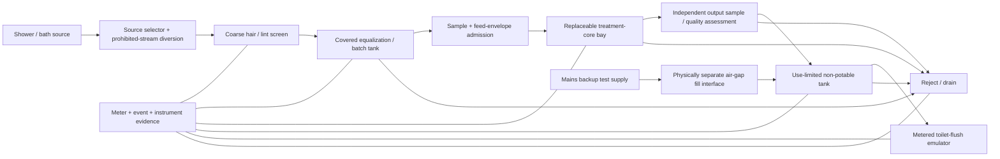

# WaterLoop modular treatment-core design review v0.1

**Date:** 16 November 2026  
**Parents:** [WaterLoop physical demonstrator #5335](https://github.com/Luminous-Dynamics/symtropy/issues/5335), [feed-envelope child #5692](https://github.com/Luminous-Dynamics/symtropy/issues/5692), [service continuity #5364](https://github.com/Luminous-Dynamics/symtropy/issues/5364), [economics #5425](https://github.com/Luminous-Dynamics/symtropy/issues/5425)  
**Evidence class:** design proposal / literature-informed; no physical validation  
**Decision:** proceed with a source-separated, replaceable-core, non-potable research demonstrator; do not freeze treatment chemistry, supplier or installed plumbing yet

## 1. Design decision

Build a **modular service platform**, not a single appliance with one permanent filter stack.

The platform has four physically separable functions:

1. source intake and source/batch qualification;
2. hydraulic conditioning and storage;
3. replaceable treatment core(s), selected only for a characterized feed and intended use;
4. use-qualified non-potable delivery plus a separately metered reject/residual route.

The first experimental stream should be **separately collected shower/bath light greywater**, not a mixed household drain. Laundry remains a separate challenge stream. Kitchen, dishwasher, toilet/blackwater, nappy/soiled laundry, chemical-cleaning, workshop/vehicle wash, animal wash and unknown mixed drainage are outside the first reuse test boundary.

Rainwater remains a distinct source and must not be treated as greywater or blended into the initial treatment comparison. It can be evaluated later as an independent source branch with its own roof/first-flush/storage evidence.

**Initial end use:** non-potable toilet-flush emulation in the unoccupied test cell. Subsurface irrigation may be a later separately assessed use. No drinking, cooking, bathing, handwashing, food-crop irrigation, occupied use or public distribution is in this design.

The physical demonstrator is not a potable-water system. The first demonstrator must be capable of proving hydraulic service and accounting even with the treatment core removed.

## 2. Why replaceable and feed-aware

The September 2026 review by Ninsiima et al. synthesized 131 empirical studies and found large feed variability: COD 100–2,000 mg/L, TSS 30–1,000 mg/L, and laundry surfactants frequently above 100 mg/L. It identifies household behaviour, source mixing, temporal variability and storage-induced transformation as important drivers of fouling, treatment efficiency, energy, maintenance and microbial risk. That is a direct argument against a universal fixed train.

The 29 October 2026 García-Agudelo et al. bench study compared:
- sedimentation → slow sand → UF → UV; and
- sedimentation → ozone → GAC → UV.

On its **synthetic contaminant mixture**, the ozone/GAC train reported 99.6% turbidity and 78% COD reduction, compared with 95.9% and 71.9% for the UF train. This is a useful candidate-comparison design, not proof that ozone/GAC is superior on actual household feed, across all contaminants or under long-run operation. Ozone adds off-gas, worker-exposure, oxidation-by-product and energy concerns that must be tested.

The July 2026 full-scale natural-treatment study reported 0.05–0.17 kWh/m³ across one household and two school installations, with 2.5 years of water-quality monitoring. That is a valuable low-energy benchmark family, but its wastewater feed, land/retention boundary, scale and uses differ from a compact residential greywater appliance. It must not be ranked against a household cartridge train using the energy number alone.

Sources:
- Ninsiima et al. (23 Sep 2026): https://doi.org/10.1007/s42452-026-09559-0
- García-Agudelo et al. (first published 29 Oct 2026): https://doi.org/10.1111/1752-1688.70162
- Halicki et al. (15 Jul 2026): https://doi.org/10.1016/j.jenvman.2026.130241
- WRC TT 746/17, *Guidelines for greywater use and management in South Africa*: https://www.wrc.org.za/mdocs-posts/tt-746-17/
- South African GN 6292, 6 June 2025: https://www.gov.za/sites/default/files/gcis_document/202506/52814gon6292.pdf

## 3. Functional process-flow proposal

The diagram is functional only. It is not a P&ID, does not define pipe sizes, valve types, pressures, pump selections, UV dose, disinfection contact time, electrical protection or installation approval.

### 3.1 Source intake

- Separate source collection from all blackwater and excluded drains.
- Provide a visibly accessible source selector and a positive diversion route for out-of-scope streams.
- Record source ID, household-event type, batch ID, timestamp, volume and exclusion reason.
- Use a coarse removable screen only for hair/lint protection. The screen is not a treatment barrier.
- The first bench feed is actual shower/bath light greywater or a clearly labelled synthetic challenge batch; never silently mix the two evidence classes.
- Keep untreated feed in closed, labelled containment and minimize residence. WRC guidance warns against storing untreated greywater beyond 24 hours; the exact operating limit for this bench must be approved in its method statement.

### 3.2 Equalization / batch conditioning

Use a removable, drainable and cleanable covered vessel with:
- measured level and separately calibrated level-to-volume relation;
- temperature measurement;
- sampling port;
- drain-down and cleanout access;
- venting arranged by qualified design review;
- batch time/age identity;
- no hidden blending between source classes.

Equalization may reduce short-term hydraulic shocks but can also change water quality during storage. The experiment must therefore measure feed at collection and at treatment inlet. Do not assume equalization is biologically or chemically neutral.

### 3.3 Replaceable process bay

Provide one standardized mechanical interface for swappable treatment-core assemblies. Each core needs:
- unique core/configuration ID and revision;
- declared feed envelope and prohibited feed conditions;
- inlet/outlet/reject ports with non-interchangeable or keyed fittings where practicable;
- stated allowable flow/pressure/temperature range;
- differential-pressure measurement points where relevant;
- energy meter boundary and standby power accounting;
- cleanout, consumable replacement and spent-media route;
- isolation and bypass state visible at the physical interface;
- independent output sampling point.

**No core earns reuse credit by being installed.** It earns credit only for a specific batch, process state, outlet measurement, quality assessment and intended-use profile.

### 3.4 Output and fallback

The treatment outlet is sampled before it enters the use tank. No quality evidence means no credited reuse.

The treated-water tank and distribution path are physically distinct from any potable or municipal drinking-water installation. If the design includes any top-up or alternate source, it must use a qualified air-gap / backflow-protected interface reviewed against the specific site hazard classification; it must not create a direct cross-connection.

The first demonstration should discharge to a closed toilet-flush emulator, not an occupied toilet. Failure of source admission, required process stage, outlet quality assessment, instrument validity, controller state or power causes isolation and diversion to the approved reject route. The fallback may be a separate non-reuse water supply to the emulator, with its own measured boundary.

## 4. Candidate cores to compare

No treatment train is selected by this review.

| Core ID | Preliminary train | Research question | Main failure / service burden |
|---|---|---|---|
| C0 | Screen + covered storage only | Establish the hydraulic/no-treatment reference | No treatment-quality pass; residence, odour, sediment and biofilm |
| C1 | Screen → settling/equalization → biologically active media or MBBR → polishing filter | Can biological treatment buffer organic-load variability at manageable energy and operator burden? | Start-up, shock loading, oxygen/power dependence, biomass handling, odour |
| C2 | Screen → settling → UF → independently validated UV | What barrier, flux, fouling and maintenance performance is achieved on the admitted feed? | Membrane fouling/integrity, UV transmittance/dose, lamp ageing, backwash and concentrate |
| C3 | Screen → settling → GAC → independently validated disinfection | Can adsorption reduce dissolved organics/surfactants without excessive media replacement? | Breakthrough, competing adsorption, spent carbon, disinfection and by-product risks |
| C4 | Ozone → GAC → UV (research comparator only) | Can the October 2026 literature configuration be replicated on real and synthetic batches? | Ozone generation/off-gas, operator exposure, dose control, oxidation by-products, energy and GAC exhaustion |
| C5 | NTSW-like / nature-based train | What is the low-energy full-boundary trade-off when land/retention are available? | Footprint, seasonal response, vectors/odour, loading, solids/compost and site ecology |

C0 is a hydraulic baseline only. C1–C5 remain candidates. C4 cannot be physically operated until ozone process safety, off-gas management, exposure monitoring and qualified operating procedures are reviewed. No automated dosing or disinfection commissioning is authorized by this design note.

## 5. Proposed module-interface contract

| Interface | Required fields / observation | Fail-closed response |
|---|---|---|
| Source inlet | source ID, batch ID, event class, volume, timestamp, feed envelope, sample identity | Unknown/mixed/out-of-envelope source → divert |
| Core inlet | flow, pressure, temperature, feed sample, core ID/revision | Missing input or core mismatch → isolate |
| Core state | process stages active, differential pressure, energy, consumables, alarms, bypass position | Required stage unavailable or stale → no output credit |
| Core outlet | flow, pressure, sample ID, method, quality disposition, uncertainty | Unadmitted/failed sample → divert |
| Use tank | level, calibrated volume, batch ancestry, residence, temperature | Invalid inventory or expired quality scope → isolate |
| Use outlet | delivered volume, pressure/flow floor, use profile, sample/quality binding | No verified use fit → zero credited service |
| Reject/residual | screen solids, sludge, backwash, concentrate, purge, overflow, spent media | Unmetered residual → water/material balance not closed |
| Energy | core + pump + UV/ozone + controls + standby, with separate meter IDs | Missing energy channel → energy efficiency metric Indeterminate |

Mycelix remains the owner of instrument/sample/timebase/uncertainty and water-quality admission. Symtropy owns the engineering topology and measured physical boundaries. Symthaea consumes evidence for bounded product evaluation. No component may self-certify its own safety or authorize an installation.

## 6. Preliminary manufacturing architecture (not a bill of materials)

Build the first assembly as a **serviceable modular rack/skid** with:
- mechanically separated source, treatment, treated-storage and reject zones;
- removable screen and settling vessels;
- standardized service panel for core inlet/outlet/isolation and sampling;
- accessible unions and drainable low points;
- spill tray and leak-containment footprint;
- separate electrical enclosure outside routine wet-service splash zones;
- labelled cable/pipe routing and sensor mounting locations;
- replaceable hoses/seals/media cartridges only where materials compatibility is known;
- serial/lot identity for wetted materials, seals, membranes, media and UV lamps;
- documented access envelope for screen cleaning, cartridge replacement, sampling and vessel removal.

Candidate wetted materials (e.g., HDPE, PP, PVC-U, stainless steel grades and elastomers) must be selected against the actual water chemistry, disinfectant/oxidant exposure, temperature, mechanical load, cleaning agents and local standards. No material is selected by this note.

Prefer:
- common, locally supportable fittings where pressure/chemical compatibility is demonstrated;
- keyed or otherwise unambiguous connections to prevent source/core misconnection;
- replaceable modules rather than one bonded assembly;
- tool access and inspection visibility over hidden compactness;
- standard fasteners and replaceable seals;
- component passports with supplier, lot, compatibility evidence and service interval.

Do not release supplier SKUs, purchase orders, pressure ratings or production drawings until the P&ID, hazard review, engineering calculations and professional design review are approved.

## 7. T0/T1 experiments

### T0 — synthetic contract and design verification

Use the existing 34-case WaterLoop evaluator and economics/continuity cases. Add no second water ledger. T0 checks:
- source/use identity is never silently crossed;
- unadmitted or stale feed/sample evidence results in Indeterminate/zero credited use;
- bypass and reject water are not counted as recovered useful water;
- module energy and residual streams are accounted exactly once;
- treatment quality cannot be inferred from online proxies;
- failed service floor cannot be rescued by low unit cost.

### T1 — closed unoccupied hydraulic demonstrator

Before any treatment trial:
1. design review and P&ID freeze by qualified local professionals;
2. dry assembly, electrical separation and containment inspection;
3. calibrated water balance and instrument admission;
4. clean-water hydraulic tests for pressure/flow, pump duty, leakage, overflow, fallback and recovery;
5. safe contaminated-water handling, sampling and waste route approved;
6. only then, a separate treatment-core method statement and laboratory programme.

### T2 — matched process comparison

Run C1/C2/C3 on the same actual source batches, randomized or blocked to avoid systematic feed differences. Use synthetic batches as a separate reproducibility panel. C4 ozone and C5 nature-based work require separate hazard/site reviews. Sample paired inlet/outlet and intermediate process points. Report every batch and failed run; do not average away excursions.

### T3 — repeatability and robustness

Repeat across:
- different household source events and occupancy patterns;
- low, median and high organic/suspended-solids loads;
- detergent/surfactant shock as a separate laundry challenge;
- different source residence times and temperature;
- power loss, restart, blocked filter, fouled membrane, depleted media and sensor failure;
- component/production-unit variation and operator-to-operator variation.

No occupied pilot follows automatically from a T3 pass; it requires separate authorization and health/safety review.

## 8. Benchmark scorecard and research targets

Report as a vector; do not collapse into a single proprietary “clean water score”.

**Service:** use-qualified litres delivered; demand coverage; critical service interval availability; outlet pressure/flow floor; time-to-first-shortfall; recovery time.

**Treatment:** paired analyte-specific influent/effluent distributions; batch exceedance fraction for the applicable use criteria; microbial risk results; membrane integrity/fouling; UV process evidence; GAC breakthrough; process upset/recovery.

**Resource:** total kWh per verified useful m³ (including standby and auxiliaries); source water recovered; reject/backwash/purge/overflow; residual dry mass; consumables; water and material mass-balance residual with uncertainty.

**Operations:** intervention hours per 1,000 useful m³; time to clean/replace; component availability; maintenance interval; mean and tail downtime; false-safe / false-reject rates; spare-part lead time.

**Economics:** installed cost, lifecycle cost, tariff-bill delta, cost per verified useful m³ and critical person-day using the existing WaterLoop economics evaluator. Retain payer and fixed-charge effects.

**Evidence:** proportion of volume with admitted batch/source/quality/metrology lineage; exact sample/method validity; calibration age; missing/stale channel rate; rejected volume; all negative-control outcomes.

### Candidate stretch targets (not claims or pass criteria yet)

- 100% of credited useful volume has an admitted source batch, treatment-core revision, outlet sample/quality disposition and intended-use identity.
- 0 potable/non-potable cross-connections in physical inspection and seeded negative controls.
- 0 unqualified bypass/reject volume credited as treated/useful.
- 100% of seeded stale/missing/incompatible feed/sample/instrument conditions isolate or downgrade rather than pass.
- 100% measured water flow paths reconcile within an independently defined uncertainty budget; unexplained residuals remain visible.
- After a T1 baseline: target ≥20% lower lifecycle cost per verified useful m³ than a matched service-equivalent comparator **without worsening service, quality, residual burden or maintenance labour**.
- Energy target is set only after a matched baseline establishes the same feed, useful volume, quality, land and service boundary. The published NTSW 0.05–0.17 kWh/m³ is a long-term reference envelope, not a household-product guarantee or immediate acceptance threshold.

## 9. Hazards and preliminary controls

| Hazard | Initiating condition | Required design control / evidence |
|---|---|---|
| Cross-connection to potable water | Plumbing error, failed check valve, improper top-up | Physical segregation, qualified hazard review, correct air-gap/backflow protection, inspection and test |
| Microbial exposure | Untreated feed, aerosol, access to tank/outlet | Closed test cell, restricted use, independent sample assessment, labelled no-contact, no occupied operation |
| Chemical exposure | Cleaning agents, detergent mix, ozone, spent GAC | Source exclusion, SDS, containment, exposure controls, approved residual route |
| Treatment breakthrough | Saturated media, damaged membrane, inadequate disinfection | Stage-state evidence, sampling, bypass isolation, replaceable core and failed-state tests |
| Stagnation / biofilm | Long residence, low turnover, high temperature | Minimize untreated storage, drainability, cleaning access, time/temperature record |
| Pressure / hydraulic failure | Blockage, pump deadhead, stuck valve | Pressure relief, pump protection, isolation, leak tray and qualified hydraulic design |
| Electrical hazard | Wet service near energized equipment | Segregated enclosure, protective devices, earthing/bonding and electrician review |
| Residual pollution | Unmetered backwash, sludge or concentrate | Closed/authorized drain route, separate measurement and material/residual ledger |

This is a preliminary hazard register, not a substitute for HAZOP/FMEA, risk assessment or professional sign-off.

## 10. Decision gates and work owners

- #5335 retains the full demonstrator design, P&ID, DFM assembly and parent design-review gate.
- #5692 owns source classification, feed-envelope and modular treatment-core comparison.
- #4531 owns the unoccupied multi-service test-cell interface and shared event protocol.
- #4902 owns whole-chain sanitation and treatment comparisons.
- Mycelix #6100 owns water-quality evidence; #6034/#6029/#6048/#6054/#6057 own instrument, measurand, uncertainty and timebase semantics.
- Symtropy #2152 owns water/material/energy/residual closure; #4958/#4959 own treatment/pump performance authorities.
- Symthaea #10500 consumes source/sample/use/time evidence; it does not authorize the treatment or installation.

**Next deliverable:** freeze the feed-envelope sampling schema and P&ID port list for #5335's design review. Do not purchase or construct a treatment module before that review.

## 11. Nonclaims

No physical module or treatment train is selected, purchased, assembled, commissioned or qualified by this document. No potable-water, microbiological-safety, SANS compliance, by-law compliance, reuse permission, energy/cost advantage or household health claim is established.
