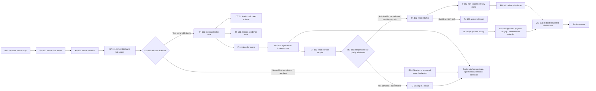
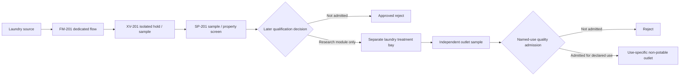
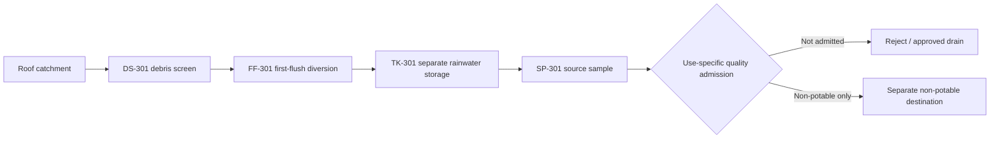

# WaterLoop modular reference architecture v0.1

**Design issue:** [WATERLOOP-MODULAR-001 #5542](https://github.com/Luminous-Dynamics/symtropy/issues/5542)  
**Integration parent:** [WaterLoop physical demonstrator #5335](https://github.com/Luminous-Dynamics/symtropy/issues/5335)  
**Date:** 16 November 2026  
**Status:** design proposal for review; not an installation drawing  
**Initial scope:** fully serviced, managed, unoccupied test cell; one separately captured bathroom greywater stream; one non-potable use (toilet cistern); no potable reclamation

## 1. Design decision

The first useful demonstrator should be a **source-segregated bathroom-greywater-to-toilet-cistern platform with a replaceable treatment bay**, but it should begin life as a clean-water hydraulic demonstrator. The greywater feed is not plumbed from an occupied building until the local permission, professional design, source sampling, risk assessment and test-cell reviews are complete.

The architecture makes four deliberate choices:

1. **Separate source streams before treatment.** The first feed is bath/shower water only. Basin, laundry, kitchen and rainwater are separate candidates, not silently pooled feeds.
2. **Qualify the treatment train against the measured feed and a named end use.** No single membrane, wetland, biofilter, GAC bed, ozone stage or UV unit is assumed universally best.
3. **Fail to a safe non-reuse route.** If source, quality, residence time, instrument, process or power evidence is invalid, reclaimed-water delivery is isolated and incoming greywater goes to an approved sewer/reject route. A failed unit must not bypass a treatment barrier to a use outlet.
4. **Keep potable and non-potable hydraulics physically separate.** No common reservoir, common pressurised header or direct cross-connection. Toilet cistern top-up is through a locally approved physical arrangement, with the correct hazard-rated backflow protection/air gap confirmed by the responsible authority and qualified plumbing designer.

The value proposition is not “a smarter tank”. It is a maintainable water-service appliance that can show: source identity → measured feed → treatment configuration → independently admitted quality for the intended use → measured point-of-use delivery → service continuity → energy, maintenance and cost.

## 2. Why source-segregation is not optional

The 23 September 2026 systematic review by Ninsiima et al. synthesises 131 empirical studies and reports very wide greywater variability: COD 100–2,000 mg/L, TSS 30–1,000 mg/L, laundry anionic surfactants frequently above 100 mg/L, and strong effects from household behaviour, source mixing, temporal variation and storage. It reports only 41% of studies were judged high robustness. A generic “greywater” feed specification is therefore not defensible.

The South African WRC guideline TT 746/17 distinguishes bathroom, laundry and kitchen sources. It describes kitchen/dishwasher greywater as a high organic / grease stream and recommends low-risk sources such as bath/shower. It also:
- says untreated greywater should not be stored longer than 24 hours;
- says only treated **and disinfected** greywater should be used for toilet flushing and other listed non-potable indoor uses;
- calls for a diversion device to the formal sewer if a treatment system fails or is overwhelmed;
- calls for municipal cistern backup if greywater toilet-flushing supply fails;
- requires labelled storage/pipes and maintenance by registered/qualified personnel;
- cautions against use in informal/unserviced settlements where risk control is difficult.

Sources:
- Ninsiima et al. (23 Sep 2026), *A systematic review of greywater properties and variability that govern decentralised off-grid treatment feasibility*, DOI: https://doi.org/10.1007/s42452-026-09559-0
- Carden et al. (2018), WRC Report TT 746/17: https://www.wrc.org.za/wp-content/uploads/mdocs/TT%20746-17.pdf

A 29 October 2026 bench-scale study compared:
- sedimentation → slow sand → ultrafiltration → UV; and
- sedimentation → ozonation → GAC → UV.

The ozone/GAC train showed higher turbidity/COD removal in that experiment, while UF/UV gave more consistent microbiological control; the ozone/GAC train had a reported heterotrophic-bacteria increase attributed to biofilm detachment. The study used a synthetic mixture and bench-scale systems. It is not proof that either train wins in an actual household. It is evidence that the module tournament must report multiple analyte and operational outcomes, not one “percent removal” result.

Source: García-Agudelo et al. (first published 29 Oct 2026), DOI: https://doi.org/10.1111/1752-1688.70162

A 2026 constructed-wetland review reports that stream-specific pretreatment is important to reduce TSS/clogging, staged hybrid wetlands can outperform single-stage configurations on some metrics, and disinfection is still needed for stringent reuse. Wetland/media biology is a candidate module where land, hydraulic retention and maintenance realities permit—not a universal compact-household answer.

Source: Morandi & Steinmetz (Aug 2026), DOI: https://doi.org/10.1016/j.coesh.2026.100737

## 3. Local approval boundary — Johannesburg first

The City of Johannesburg Water Services By-law, 2004, as found in the consolidated version including amendments through 6 June 2025, section 50 says use of water from a source other than the municipal water supply requires prior Council permission, with a stated exception for rainwater tanks not connected to the water installation. It also contains requirements for installation drawings/permission and qualified plumbers.

This has a direct architecture consequence: **do not assume a household greywater reuse circuit can simply be connected to the existing Johannesburg plumbing.** Obtain a current City/legal interpretation of section 50 and the required building/plumbing approvals before any occupied-site connection. The consolidated source is historical; verify the operative text and current municipal requirements before relying on it.

Source: https://lawlibrary.org.za/akn/za-jhb/act/by-law/2004/water-services/eng@2009-09-30

SANS 10252-1:2018 Edition 3.2 Annex D describes potable-supply protection, hazard-rated backflow prevention, approval and permanent non-potable outlet/pipe marking. The exact current SABS-controlled edition and amendments must be checked by the qualified designer; the publicly referenced copy is not an authorization to reproduce the standard.

Publicly referenced edition: https://www.uj.ac.za/wp-content/uploads/2022/11/sans-10252-1-water-supply-and-drainage-for-buildings-part-1-water-supply-installations-for-buildings-2018.pdf

The national GN 6292 (6 June 2025), regulation 12, adds risk-identification/W₂RAP requirements where a Water Services Institution plans collection/use of greywater beyond a household boundary. This reference design is a single-property test-cell concept. A community/shared system requires a separate institutional, operator and risk-plan review.

Source: https://www.gov.za/sites/default/files/gcis_document/202506/52814gon6292.pdf

## 4. System boundary and P&ID-style concept

### 4.1 Circuit A — initial greywater feed and non-potable use

The first feed is **bath/shower only**. Hand-basin may be a later candidate after sampling; laundry and kitchen remain isolated.

This is a functional block P&ID, **not** a construction drawing. Pipe sizes, valve types, air-gap dimensions, backflow category, tank classification, pressure ratings, relief, electrical protection, sewer consent and actual equipment selection are deliberately not specified until the site and professional design are frozen.

The diversion valve should be arranged so loss of control power, loss of instrument validity, maintenance, quality rejection or high-high level does not create an unverified path to reuse. The detailed fail position must be confirmed by hazard analysis (e.g. gravity default to reject/approved sewer where physically feasible); the reuse branch is normally isolated until every required admission is present.

### 4.2 Circuit B — laundry research inlet (not connected to Circuit A)

Laundry is separated because surfactants, sodium and boron may alter treatment operation and soil/plant risk. No default garden irrigation or toilet-flush credit is assigned. Laundry cannot be blended into Circuit A simply to increase nominal throughput.

### 4.3 Circuit C — rainwater (future source module; separate from greywater)

Rainwater does not enter the greywater treatment train or potable distribution. Roof materials, first-flush, tank hygiene and intended use need their own qualification. The initial demonstrator should not couple rainwater and greywater until both are independently understood.

### 4.4 Potable/non-potable barrier

- Physically separate reservoirs and distribution pipes.
- No shared pressurised header or common pump.
- No direct cross-connection.
- Municipal backup only via the local authority-approved air-gap/backflow solution and hazard category.
- Permanent pipe and outlet identification and warning labels.
- No shared garden hose bib / maintenance tap that can be mistaken for potable supply.
- No double-partition tank shortcut in v0.1; separate tanks are the default.
- No conductivity, turbidity, UV sensor, model output or “clear-looking water” can admit water as potable.

## 5. Treatment bay — interchangeable candidate modules, not a selected process

The first test-cell architecture uses a **standard service bay** with independently isolatable modules and sample ports at every boundary.

### 5.1 Functional slots

| Slot | Purpose | Candidate module families | Mandatory evidence |
|---|---|---|---|
| M0 — source conditioning | Remove gross hair/lint/settleable solids; protect downstream equipment | Removable coarse screen / lint basket; optional settling stage | Headloss, capture/cleaning frequency, bypass-to-reject, material compatibility |
| M1 — primary treatment | Reduce the feed's measured organic/solids/microbial load | Attached-growth biological; media biofilter; compact wetland/media cell; sand filtration; UF (where justified) | Feed envelope, flow/loading, analyte panel, fouling/biological stability, energy/land/footprint |
| M2 — polishing | Control remaining measured target contaminants | GAC/adsorption; fine filtration; UF or other validated barrier | Breakthrough/consumable life, pressure loss, residual/reject, analyte-specific output |
| M3 — final disinfection | Provide the validated microbiological barrier for the declared use | UV or chemical disinfection only after engineering and independent review | Validated operating envelope, contact/dose/UV transmittance as relevant, alarm/interlock, residual strategy where applicable |
| M4 — treated storage/delivery | Preserve the admitted quality and deliver the declared use | Separate covered buffer, dedicated pump, outlet sample port | Residence-time / regrowth assessment, turnover, energy, pressure/flow, overflow and back-up behaviour |

The slots are interface functions, not a promise that every train requires every slot. No disinfectant chemistry, dosage, UV dose, membrane operating pressure, contact time or effluent numerical threshold is selected by this document. Those require a qualified process design based on admitted influent, target use, applicable quality criteria, equipment data and independent validation.

### 5.2 Candidate trains to compare

1. **Bio/media + polishing + disinfection** — candidate where biodegradable load, footprint and service/cleaning skill make it sensible.
2. **Sand/media + UF + UV** — benchmarked against the October 2026 residential bench study's lower organic removal but stronger reported microbial control.
3. **GAC/adsorption + disinfection** — targeted only at analytes demonstrated in the feed; media exhaustion and biological detachment must be measured.
4. **Hybrid modular wetland/media + polishing + disinfection** — a nature-based candidate for larger sites where land/retention are feasible; not assumed compact enough for every dwelling.
5. **Ozone-assisted GAC** — research-only candidate requiring sealed engineering, off-gas/worker safety assessment, ozone destruction/containment and evidence for the observed microbiological trade-offs. Not in the first household build.

The decision rule is: select the least complex train that reliably meets the declared quality/use and service requirement across the measured source variability, including failure and maintenance modes. Do not optimise removal percentage while ignoring residuals, energy, cost, fouling, microbial breakthrough, maintenance or downtime.

## 6. Module mechanical/electrical/evidence interface

Every module boundary must expose the same categories:

| Interface | Contract |
|---|---|
| Hydraulic inlet/outlet | Defined connector/material, maximum working pressure, flow envelope, direction, isolation and drain-down |
| Reject/residual | Separate labelled output, measured flow or batch mass, containment and approved disposal route |
| Sampling | Inlet/outlet representative sample point; cleanable, identified, no dead-leg assumption |
| Instruments | Exact channel ID, measurand, unit, location, sample time/valid time, calibration, uncertainty, validity and missing/stale semantics |
| Energy | Module-level kWh and peak power, separated from other modules |
| Process identity | Module ID, revision, serial/lot, wetted materials, firmware/config, commissioning date |
| Operating envelope | Feed-quality constraints, flow/loading limits, temperature range, start/stop, alarm and reject behaviour |
| Maintenance | Access envelope, isolation/lockout, cleaning, consumables, replacement interval evidence and service skill |
| Qualification | Independent methods/results tied to exact module revision and intended-use profile; swap invalidates prior qualification until rechecked |

A module can claim only the function and feed/use envelope that its evidence supports. A downstream module cannot inherit upstream treatment credit without an end-to-end outlet assessment.

## 7. First demonstrator — smallest useful build sequence

### Stage 0 — design/dry build (no greywater reuse)

- Freeze the physical room/test-cell layout and all maintenance access zones.
- Produce a drawing set and site-specific hazard review with a qualified local plumber/electrical designer.
- Assemble empty/clean modules and verify clearances, unions, drain-down, labels and module swap procedure.
- Verify electrical isolation, containment and alarm paths before pumping water.

### Stage 1 — clean-water hydraulic bench

Use clean water only. No wastewater source, no chemical challenge recipe and no use outlet connected to occupied plumbing.

- Test source meter, tank geometry/level-to-volume relation, transfer pump, pressure/flow boundary, non-potable delivery meter and reject meter.
- Exercise safe diversion, power loss, stuck valve, overflow and manual isolation.
- Verify water balance, pump duty, pressure/flow and energy.
- Use a fixture-equivalent test load or isolated test cistern; do not connect to domestic plumbing without the approvals.

### Stage 2 — source characterisation (no reuse)

After approval for test-cell source collection, characterise separately collected bathroom greywater over realistic temporal variation. Measure source flow, timing, storage age and the analytes chosen by the independent water-quality reviewer. Keep captured water in a managed test boundary and dispose of it through the approved route. Do not feed it to a use point.

### Stage 3 — treatment-module comparison (unoccupied, controlled)

Only after the source envelope, intended use, analytical panel, treatment design and residual route are reviewed:
- Compare matched candidate trains with identical feed batches and hydraulic loading.
- Sample every stage and the final outlet through an independent qualified laboratory/method.
- Challenge low/high feed envelope, intermittent flow, stagnation, cleaning, power loss and controlled fault conditions.
- Measure quality, water balance, energy, reject, pressure loss, maintenance labour, module recovery and service output.
- The water-quality owner determines whether output is admitted for the named non-potable use.

### Stage 4 — controlled toilet-cistern service trial

Only after all local approvals and independent quality/process gates are met. Keep the potable backup arrangement physically independent. Test source outage, treatment fault, quality rejection, power fault, demand surge, tank depletion and recovery. No drinking, cooking, shower, handwashing or food-crop irrigation use is included.

## 8. P&ID tag register

| Tag | Component / measurement | Function |
|---|---|---|
| FM-101 | Source flow meter | Measure admitted bath/shower feed |
| XV-101 | Source isolation | Isolate collection path |
| ST-101 | Removable hair/lint screen | Protect downstream modules |
| DV-101 | Three-way fail-safe divert | Default to approved reject; enables test-cell route only when permitted |
| TK-101 | Raw equalisation tank | Short-duration untreated buffer, elapsed-time evidence |
| LT-101 | Tank-level instrument | Level only; volume derived from independently calibrated geometry |
| TT-101 | Residence-time clock / evidence | Trigger reject/hold when 24-hour untreated limit is exceeded |
| P-101 | Transfer pump | Deliver source through module bay |
| MB-101 | Replaceable treatment bay | M0–M3 candidate module slots |
| SP-101/102 | Stage sample ports | Independent process / final outlet samples |
| QG-101 | Quality admission interface | Mycelix-bound use-specific quality disposition; no self-certification |
| TK-102 | Treated-water buffer | Separate covered, controlled residence storage |
| P-102 | Non-potable delivery pump | Dedicated downstream delivery |
| FM-102 | Use delivery meter | Meter actual point-of-use delivered volume |
| WC-101 | Test cistern / fixture equivalent | Declared service boundary |
| AG-101 | Approved mains air gap/backflow arrangement | Separate cistern fallback/top-up; exact design by authority |
| RJ-101/102/103 | Reject / overflow / purge | Separately measured residual outputs |
| EM-101 | Module energy meter(s) | Electrical energy per process boundary |
| PT-101/102 | Pressure taps | Pump suction/discharge and use boundary |
| DP-101 | Differential pressure | Screen/filter/membrane fouling indicator where applicable |

## 9. Failure-mode and challenge matrix

| Challenge | Observable | Expected safe outcome | Evidence |
|---|---|---|---|
| Feed outside admitted source class | Source ID / operator observation / sample | Divert to reject; do not pool into Circuit A | Source identity and valve receipt |
| Untreated residence exceeds 24 h | Capture timestamp / current time | Reject or validated treatment-only route; no untreated use | Timestamp and reject meter |
| Power loss | Energy channel, controller state | Reclaimed delivery off; raw feed to reject; independent cistern fallback remains | Power/fault receipt |
| Source meter stale or invalid | Channel validity | No feed/service credit; divert | Mycelix channel admission |
| Treatment stage blocked | Differential pressure / flow / inspection | Isolate module, reject incoming stream | Module state and flow/pressure |
| Membrane integrity failure (if present) | Validated integrity test / pressure decay | Isolate; no bypass to use | Test method and module revision |
| GAC exhaustion (if present) | Analyte-specific breakthrough | Isolate/replace; no performance credit | Lab sample pair, media identity |
| Disinfection barrier unproven | Validated process channel + independent sample | Close non-potable delivery; divert | Quality admission and interlock |
| Treated tank high-high | Level/overflow measurement | Stop capture/delivery or divert to approved reject | Independent level/overflow evidence |
| Pump failure | Pressure/flow mismatch | Stop reuse pump; municipal cistern backup only | Pressure/flow/fallback receipt |
| Suspected cross-connection | Isolation challenge / pressure or tracer test by qualified reviewer | Quarantine both systems; do not resume until independently inspected | Plumbing inspection record |
| Service restoration after repair | Same boundary flow/pressure/quality | Stable-dwell and independent verification before restore | Repair event + new acceptance receipt |

## 10. Measurement and qualification

Minimum measurements:
- source, reject, stage inlet/outlet, overflow, backwash/purge, treated-buffer and useful point-of-use volumes;
- tank level and validated level-volume mapping;
- pressure/flow at pump suction/discharge and actual cistern fill;
- energy for each pump/treatment module;
- elapsed source age, treated-water storage time, downtime and alarm state;
- pH, temperature, conductivity and turbidity as process indicators only;
- independent lab microbial and chemical panel based on the declared feed and intended use;
- residual mass and disposal evidence for spent media, sludge, concentrate, cleaning and reject.

Use Mycelix instrument/uncertainty/timebase authorities. Every instrument must have an admitted measurand, calibration/verification, uncertainty, channel identity and field-condition applicability. Sensors do not replace laboratory assessment. Quality admission must be tied to sample ID, batch/source, method, lab, detection limit, result, date, use profile and exact system configuration.

Water-balance boundary:

`source + municipal top-up = useful delivery + sewer reject + overflow + purge/backwash + storage change + residual uncertainty`

Do not force residual closure by assigning missing measurements to zero.

## 11. Matched industry benchmark

| Architecture | What it demonstrates | What must be measured for a fair comparison |
|---|---|---|
| Direct municipal supply | Baseline service, no on-site reuse complexity | Bill, service interruptions, pressure/flow and use volume |
| JoJo-type tank/pump | Backup storage and pressure delivery | Delivered service, energy, source replenishment, maintenance and true outage coverage |
| Hydraloop H300 | Residential shower/bath recovery and non-potable service; product page declares 360 L/day potential capacity and up to 45% reduction | Actual source flow, output useful volume, outlet quality, energy, reject/purge, duty/standby, filterless maintenance burden and installation costs |
| UF + UV train | Physical membrane + UV barrier | Quality panel, membrane integrity/fouling, energy, cleaning, residuals and microbial performance |
| Sand/media + GAC + UV | Media filtration/adsorption + disinfection | Analyte-specific breakthrough, microbial control, media life, cleaning and residual disposal |
| Biological / wetland hybrid | Lower-energy, nature-based process candidate | Land/retention, seasonality, clogging, maintenance, energy, quality and residual management |
| WaterLoop modular | Replaceable, source-specific process modules + safe service continuity | All above, plus time-to-safe-state, module interchangeability, local spares, maintainability and independently verified service cost |

The Hydraloop figure is a manufacturer-declared potential capacity and savings claim; it is not treated as achieved household service. The October 2026 bench comparison is a controlled synthetic-feed reference only. Comparisons must match feed quality, duty, intended use, quality criteria, duration and system boundaries.

Success is not one weighted score. Report a Pareto frontier across:
- quality/use safety;
- verified service volume and continuity;
- energy;
- installed/lifecycle cost;
- footprint;
- residual/environmental burden;
- maintenance labour and skills;
- local supply/repair resilience.

## 12. T0/T1 acceptance gates and stretch targets

### Design/T0 gate

- source-use-quality types and source-reject mappings are machine-readable;
- no untyped source mixing or cross-use service credit;
- all normal and failure paths map to a physical destination;
- all safety-critical states have a defined passive outcome;
- every module has isolation, drain, sample, residual and maintenance interfaces;
- the P&ID and failure modes are reviewed by local qualified plumbing/electrical/water-quality professionals before any build.

### Physical T1 gate

- clean-water hydraulic balance closes within the declared metrology uncertainty;
- all pump/flow/pressure measurements bind to calibrated channel identities;
- all test fault injections demonstrate the expected safe state;
- treatment performance is evaluated from paired independent inlet/outlet sample sets across multiple representative feed batches;
- output quality is qualified for the named non-potable use; no other use inherits the credit;
- repeatability is demonstrated across repeated runs and representative component variation.

### Research targets (not achieved claims)

- 100% source traceability from inlet to use/reject;
- 100% seeded safety-critical faults enter the specified reject/isolate state;
- zero direct potable/non-potable cross-connection;
- 100% mass/energy flow paths reconciled within the declared uncertainty;
- >=99% critical-service interval availability within a frozen, physically tested design envelope;
- >=95% declared toilet-cistern demand fulfilled in a frozen 72-hour source/power-outage experiment without breaking any treatment or potable protection barrier;
- 20% lower lifecycle cost per verified useful m³ and 20% lower energy per verified useful m³ versus matched alternatives only after physical baseline and independent cost/service evidence exist.

These are targets for future tests; they are not product claims.

## 13. DFM and serviceability — initial BOM categories only

No supplier SKUs or procurement quantities are frozen. The first engineering BOM should contain categories:

- source isolation and diversion valves;
- removable coarse strainer and service basket;
- raw equalisation tank with hygienic access/vent/overflow configuration subject to professional design;
- independently calibrated level/volume measurement;
- transfer and non-potable delivery pump candidates with published curves and energy data;
- modular skid/backplate or rail with labelled inlet/outlet/reject/sample/energy interfaces;
- candidate treatment cartridges/media/membrane/disinfection modules for the tournament;
- covered treated buffer, dedicated non-potable delivery and cistern test fixture;
- approved reject/residual containment and sewer interface subject to authority;
- pressure gauges/transducers, flow meters, temperature/process channels and electrical energy meters;
- spill tray, leak containment, drain-down, isolation and lockout provisions;
- accessible unions, standard replaceable seals and locally serviceable fittings;
- spares and consumable sets with documented life and waste disposition.

The design review must explicitly compare tank materials, wetted plastics/metals, seal compatibility, UV exposure, cleaning chemicals, corrosion, microbial biofilm management, acoustic/noise, heat exposure, installation access and end-of-life.

## 14. Decision record

**Selected first build:** clean-water hydraulic test cell with the Circuit A physical envelope laid out, source/reject/treated/use measurement points, module bay and an isolated cistern-equivalent load. This can establish assembly, leakage, hydraulics, instrumentation and safe-diversion behavior without making a greywater quality claim.

**Deferred:** real greywater feed, process module selection, GAC/ozone, wetland, laundry and rainwater integration, occupied installation, any potable treatment and any municipal interconnection.

**Reason:** source variability, treatment trade-offs, local permission and public-health consequences dominate the risk of premature hardware selection. A clean-water hydraulic first article produces useful engineering evidence while the feed and legal/quality boundaries are qualified.

## 15. Nonclaims

This document is not a construction drawing, plumbing permit, electrical design, process design, treatment validation, product specification or purchasing authorization. No physical demonstrator is qualified by this document. No water is approved for drinking, cooking, bathing, handwashing, laundry, food-crop irrigation or human-contact garden use. No installation is authorized until the applicable current Johannesburg / site authority approvals and qualified professional designs are obtained.
