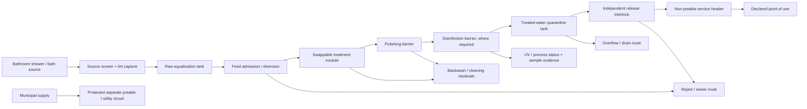

# Modular WaterLoop Reference Architecture v0.1

**Date:** 16 November 2026  
**Parent design owner:** [WATERLOOP-PHYSICAL-DEMO-001 #5335](https://github.com/Luminous-Dynamics/symtropy/issues/5335)  
**Modular process child:** [#5644](https://github.com/Luminous-Dynamics/symtropy/issues/5644)  
**Service continuity:** [#5364 / PR #5368](https://github.com/Luminous-Dynamics/symtropy/pull/5368)  
**Economics:** [#5425 / PR #5429](https://github.com/Luminous-Dynamics/symtropy/pull/5429)  
**Evidence class:** concept / design specification; not a commissioned system  
**Claim ceiling:** architecture and interface contract only; no treatment or potable qualification

## 1. Design objective

WaterLoop should be a **source-aware, modular water-service utility**, not a monolithic greywater appliance. It should deliver a named, safe, useful water service under source interruptions, power loss, demand variation and maintenance, with every stream accounted for and each treatment barrier independently replaceable and verifiable.

The optimisation target is not maximum nominal throughput or pollutant-removal percentage in isolation. It is:

> Verified, use-qualified water delivered at the point of use over time, within a declared quality envelope, energy/cost/maintenance budget and safe residual-disposal route.

The system has four separate boundaries:

1. **Source boundary** — where each distinct raw source enters, and where source identity/quality are assessed.
2. **Process boundary** — equalisation, treatment, polishing, disinfection, quarantine, cleaning and reject streams.
3. **Service boundary** — the actual outlet and use class receiving the product water.
4. **Evidence boundary** — the independently admitted measurements, samples, calibration, configuration and maintenance events supporting each service claim.

These are separate water inventories. Do not combine potable supply, bathroom greywater, laundry water, kitchen wastewater, blackwater, stormwater, groundwater and treated non-potable water into a single untyped volume.

## 2. Evidence-informed design premise

Greywater is not a stable feedstock. A September 2026 systematic review of 131 empirical studies reports broad variation in organic load, suspended solids, surfactants and microbial indicators. It concludes that source mixing and temporal variability affect treatment performance, fouling, maintenance and health risk. This is a reason to separate feeds and test challenge envelopes, not a justification for a universal greywater recipe.

A 29 October 2026 residential bench study compared two **synthetic-feed** light-greywater trains:
- sedimentation → slow sand → ultrafiltration → UV;
- sedimentation → ozonation → granular activated carbon → UV.

The two configurations had different relative strengths: the ozone/GAC train reported stronger turbidity/COD outcomes on that study's synthetic feed, while the UF/UV train showed better microbiological reductions. The ozone/GAC configuration also exhibited a heterotrophic bacteria increase associated with biofilm in the reported test. This is a useful warning against ranking treatment trains on a single contaminant or a synthetic bench result.

An August 2026 review of constructed wetlands highlights stream-specific pretreatment, hybrid/multi-stage arrangements and the role of post-disinfection for more stringent reuse contexts. A July 2026 full-scale nature-based treatment study reports energy use of 0.05–0.17 kWh/m³ across three sites, but those systems have different feed, land and service boundaries from a compact residential appliance.

Manufacturer data also need correct denominators. The July 2026 Hydraloop H300 manual declares 100 L internal volume, 360 L/day nominal throughput and 280 kWh/year average consumption. At the full declared throughput this arithmetic is 2.13 kWh per nominal m³; it is not measured energy per actual useful delivered m³ or a verified household saving. The manual also gives an indoor installation envelope and pump duty limits that must be respected in any matched comparison.

Sources:
- Ninsiima et al. (2026), greywater variability review, DOI: https://doi.org/10.1007/s42452-026-09559-0
- García-Agudelo et al. (2026), residential treatment-train bench comparison, DOI: https://doi.org/10.1111/1752-1688.70162
- Morandi & Steinmetz (2026), constructed wetlands review, DOI: https://doi.org/10.1016/j.coesh.2026.100737
- Halicki et al. (2026), full-scale nature-based systems, DOI: https://doi.org/10.1016/j.jenvman.2026.130241
- Hydraloop H300/H600 installation manual (2026): https://static1.squarespace.com/static/6809d6b186796545157fbf2f/t/6a55b27199175d688f397fb5/1784001140399/Hydraloop%2Binstallation%2Bmanual%2B-%2BJuly-2026.pdf

## 3. Architecture decision: separate first, merge only after admission

### Initial source scope

| Source | v0 demonstrator treatment | Reason |
|---|---|---|
| Bathroom shower/bath light greywater | Candidate feed, separately collected | Lower solids/grease burden than mixed household wastewater; still highly variable and requires measured challenge profile |
| Bathroom basin | Excluded until characterised | Variable soap, hair, cleaning products and possible cross-source contamination |
| Laundry | Separate future challenge branch | Surfactants, sodium, boron, lint, detergents, pH and batch shocks may demand a different pretreatment |
| Kitchen | Excluded from v0 | Fats/oils/grease and food solids change clogging and treatment demands |
| Toilet / blackwater | Physically excluded | Different hazard and process train; not a greywater feed |
| Roof / stormwater | Separate system | Roof material, first-flush and event-dependent contamination; do not silently mix with greywater |
| Municipal / borehole / tanker | Separate identified source | Source-specific quality and authority; no silent blending |

The first process demonstrator should be **non-potable bathroom light greywater only, in the unoccupied test cell**, using a frozen source profile. Laundry, kitchen, blackwater and stormwater are separate later research tracks. No potable reuse is in scope.

### Concept-level process flow

The drawing is a process concept, not a pipe-and-instrument drawing. #5335 remains the owner of the demonstrator's physical P&ID, tank and pipe sizing, instrumentation placement and test-cell layout.

## 4. Modular treatment backbone

The invariant interface is:

`source admission → equalisation → primary separation → selected process module → polishing → disinfection (if required) → treated-water quarantine → qualified release → segregated non-potable use`

The process stages are **slots**, not a declaration that every site requires every stage. Each selected process must have a documented rationale against the input challenge and intended output/use envelope.

### Module contract

Every physical module shall publish a machine-readable descriptor with:

- stable module ID, version, manufacturer/design authority and serial/lot identity;
- process purpose and allowed upstream/downstream port classes;
- declared influent ranges and challenge profile, with units and measurement method;
- design flow/loading range, pressure/head-loss envelope and operating temperature;
- output claims, intended-use class and the evidence required before any release;
- start-up, shutdown, bypass, hold and fail-safe states;
- electrical power, energy boundary, standby load and auxiliary loads;
- consumables/media identity, life criteria, cleaning, replacement and spare availability;
- backwash, purge, spent media, sludge or other residual routes;
- fault indications, alarm semantics and manual recovery instructions;
- required sampling points, measurands, timebase and uncertainty;
- verification method and acceptance protocol.

A module cannot grant itself quality admission. Its declaration is a design envelope, not proof that a site installation is within that envelope.

### Candidate process families (not selected)

| Candidate | Conceptual train | Strength to test | Critical failure modes / questions |
|---|---|---|---|
| A — compact physical barrier | Equalisation → sedimentation → UF → UV | Compact footprint; particle barrier; measurable membrane integrity | Fouling, TMP/head loss, integrity failure, UV transmittance/dose, lamp degradation, cleaning/reject volume |
| B — oxidation / adsorption | Equalisation → ozone → GAC → UV | Oxidation plus adsorption may address some dissolved organics/colour/odour | Oxidant residual/off-gas safety, by-products, GAC breakthrough, biofilm/regrowth, UV dose/transmittance |
| C — nature-based hybrid | Pretreatment → vertical-flow / multi-stage wetland → polishing/disinfection as required | Low operational energy potential; biological and media processes | Land/footprint, clogging, hydraulic loading, temperature/season, vectors/odour, media life, maintenance effort |
| D — source-specific hybrid | Bathroom train + separately qualified laundry train; independent source tanks; merge only after assessment | Allows distinct feed challenges and use cases | Cross-connection, mistaken source identity, incompatible batch chemistry, combined-storage recontamination |

No candidate is selected by percentage COD or turbidity removal alone. Selection requires a matched test on the same source profile, useful outlet volume, quality analytes, energy, cost, maintenance, residuals and failure/recovery behaviour.

## 5. Storage and distribution design rules

- Raw equalisation and treated-water quarantine are separate tanks with independent levels, drain/overflow and cleaning access.
- Treated water remains quarantined until the required process, sample and operational admission are valid for the declared use. A tank residence period is not automatically a disinfection barrier.
- Storage design shall include drainability, cleanability, covered access, overflow management, vector exclusion and a defined inspection route.
- Product distribution is explicitly identified and physically segregated as non-potable.
- There is no direct or implicit interconnection to drinking-water fixtures.
- Any municipal make-up supply is a separate protected circuit. The approved physical separation/backflow solution and all code requirements are determined by the qualified local plumbing designer; this document does not prescribe a device or connection method.
- Every output port is tied to a named intended-use profile; use classes cannot be reassigned by software alone.

## 6. Safe states and fail-closed operation

| Fault / uncertainty | Required physical behaviour | What must not happen |
|---|---|---|
| Critical quality sample failed, unavailable or stale | Close reuse release; quarantine or divert to approved residual route | Continue release because last sample passed |
| UV / disinfection barrier unavailable or outside its validated operating envelope | Stop release for uses requiring that barrier; hold/divert and use protected fallback | Treat UV power-on as proof of achieved dose or water safety |
| Membrane integrity / pressure condition fails | Isolate module; stop product credit; route feed safely | Bypass membrane and continue claiming treated product |
| Sensor failure or disagreement | Enter defined conservative hold/diversion state | Let an AI estimate replace missing critical measurement |
| Power failure | Stop powered treatment/release; protect tanks and prevent backflow; preserve separate mains service | Release untreated water from raw storage |
| Pump failure | Stop pumped branch; allow gravity/manual fallback only when that exact branch is independently designed and admitted | Assume nominal head/flow without measurement |
| High turbidity / out-of-envelope feed | Isolate or divert source batch; record batch and reason | Dilute unknown feed and treat it as admitted |
| Tank high level / overflow | Isolate inflow or divert to approved route | Overflow into building or stormwater without an authorised route |
| Media/GAC exhausted or replacement identity unknown | Isolate module pending replacement and commissioning evidence | Continue operating on calendar estimate alone |
| Communications / cloud outage | Keep deterministic local safe control and manual status/override per approved design | Depend on cloud for safe release or isolation |

AI can propose maintenance, identify anomalies or explain evidence. It is not a treatment barrier, quality authority or autonomous release authority. Safe operation must not depend on internet access.

## 7. First unoccupied test-cell prototype

Use a small, bounded demonstrator and freeze a single source/use profile. #5335 owns the detailed P&ID and test cell; this child defines the compare-and-verify process.

### Matched alternatives

1. **Baseline G:** simple collection/equalisation plus gravity or measured pump delivery without reuse treatment. It is a service/energy/maintenance baseline, not a claim that raw greywater is safe to reuse.
2. **Compact train A:** a fixed, fully specified UF+UV arrangement with manufacturer/model/membrane/UV identity, design limits, commissioning procedure and cost.
3. **Hybrid train C:** a specified pretreatment + nature-based/biological stage + fit-for-use polishing/disinfection arrangement, with land/area and maintenance fully charged.

Train B (ozone/GAC/UV) remains an alternative if safety engineering for ozone and by-product analysis are in the test plan; do not select it merely because one synthetic bench study reports stronger COD/turbidity outcomes.

### Freeze before testing

- source identity, capture boundary and representative feed challenge;
- intended use and use-specific quality assessment method;
- demand trace and test horizon;
- water temperature, feed variability, storage age and batch identity;
- configuration/serial/media/firmware;
- meter calibration and measurement uncertainty;
- sampling plan, analytes, laboratory/method and sample custody;
- electrical boundary and energy measurement;
- maintenance actions/time and residual/reject routes;
- identical trial windows and fault/outage scripts for all alternatives.

Physical trials begin only after plumbing/electrical/process review, test-cell risk review, appropriate sample plan and the applicable authorisations. No occupied-dwelling connection is part of this first test.

## 8. Benchmark scorecard and target gates

Measure all of the following independently. Do not collapse them into a weighted marketing score.

| Dimension | Metric | Proposed future target / interpretation |
|---|---|---|
| Useful service | Admitted use-qualified volume delivered at outlet | ≥95% of declared essential non-potable demand within the frozen design envelope |
| Quality | Each applicable analyte / indicator vs use-specific requirements | Zero release on unknown/failed critical evidence; no pooled pass hides an individual exceedance |
| Continuity | Critical interval availability, first shortfall, recovery time | Report distribution by fault and source profile; no single average masks worst event |
| Energy | Metered kWh / verified useful m³ | Compare against matched train and same outlet pressure/flow duty |
| Cost | Lifecycle cost / verified useful m³ | Target ≥20% improvement only if service and quality are not worse and residual burden is included |
| Maintenance | Planned and unplanned service hours, consumables, interventions | Target ≤1 unplanned operator intervention / 30 operating days after commissioning; report planned time separately |
| Residuals | Backwash, purge, reject, spent media, sludge and final route | 100% measured/estimated with uncertainty and identified final destination |
| Resilience | Power/sensor/pump/process/communications fault response | 100% of seeded critical faults reach the declared safe state |
| Cross-connection safety | Physical isolation inspection/test | Zero unprotected potable/non-potable cross-connections |
| Evidence quality | Calibration, sample identity, configuration and receipt completeness | 100% critical claims have source-bound evidence and an exact configuration identity |

The numerical targets are research targets for future physical experiments, not accepted standards, current capability or a product claim.

## 9. Digital evidence interface

Compose existing owners and use their identifiers; do not create a second registry.

| Evidence item | Owner / integration |
|---|---|
| Time-resolved delivered/unmet service, reserve and outage | Symtropy WaterLoop T0 #5368 / #5364 |
| Cost per useful volume and utility bill comparison | Symtropy WaterLoop economics #5429 / #5425 |
| Physical demonstrator/P&ID/test-cell | Symtropy #5335 / habitat #4531 |
| Source, outlet and process measurands / calibration / uncertainty | Mycelix #6034, #6029, #6048, #6054, #6057 |
| Water quality samples vs intended-use assessment | Mycelix #6100 |
| Asset/module/work-order and maintenance lineage | Existing Symtropy asset/service owners; link by their stable IDs |
| Household outcomes and total household cost context | Sol-Atlas #694, #700, #816 |

Each measurement/event binds to: source ID and batch; module ID/version/serial/media lot; test configuration; timebase; instrument/channel; calibration/uncertainty; sample/method/result; operator/role; maintenance/fault event; destination or end-use; and exact evidence digest.

## 10. Manufacturing and serviceability design gates

Before a design is released for prototype fabrication:

- every wetted material, seal, hose, membrane and media container has supplier, material identity, compatibility envelope and replacement source;
- every module has mechanical/electrical/hydraulic interface definition, orientation and keyed connections;
- all routine service tasks have tool list, procedure, time estimate, isolation/drain-down and safe residual route;
- consumable end-of-life is determined by measured performance/validated manufacturer criterion, not arbitrary dashboard prediction;
- local parts availability, supply lead time and substitute equivalence are recorded;
- lifting, access, wet mass, leak containment, electrical environment and service clearances are reviewed;
- pressure rating and test limits are independently reviewed by qualified professionals;
- each built unit has configuration/serial identity and a repeatable commissioning record.

No bill of materials, component sizing, pipe schedule, electrical circuit rating or construction sequence is released by this concept document. Those belong in the reviewed P&ID and detailed design package under #5335.

## 11. Explicit nonclaims

This architecture does not qualify any treatment process, water-quality result, potable output, SANS 241 compliance, reuse permission, product certification, installed safety, cost saving, energy intensity, household health outcome or manufacturing readiness. No module is selected or approved for build merely by appearing in the candidate table.
