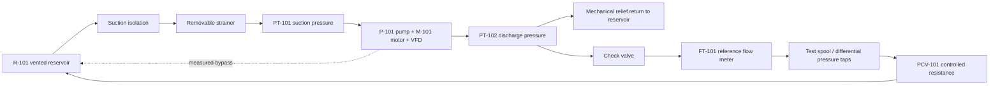

# PUMP-T1-CW-01 — First Clean-Water Pump Bench Design Basis v0.1

**Tracking issue:** [Symtropy #4994](https://github.com/Luminous-Dynamics/symtropy/issues/4994)  
**Parent benchmark:** [#4959 Pump-system service](https://github.com/Luminous-Dynamics/symtropy/issues/4959)  
**Programme PR:** [#4962](https://github.com/Luminous-Dynamics/symtropy/pull/4962)  
**Status:** parameterized design basis, not construction drawings or an approved pressure/electrical system.

## 1. Design objective

Freeze one small, closed-loop, clean-water pump duty for a first T1 bench so the team can compare real pump curves, pipe/system losses, VFD and throttling operation, energy boundaries and instrument uncertainty under controlled conditions.

This is deliberately a **single-component / single-system demonstrator**, not a universal rig for potable treatment, wastewater solids or high-capacity flood pumping. Those require different wetted materials, pressure/flow envelopes, solids passage, sampling, residual handling and safety reviews.

## 2. PUMP-T1-CW-01 profile

| Parameter | Initial target | Status |
|---|---:|---|
| Fluid | Clean water | Hard initial scope |
| Temperature | Ambient laboratory water; measure actual | Proposed |
| Flow envelope | 0.2–1.0 L/s (0.72–3.6 m³/h) | Proposed |
| Total dynamic head | 5–25 m | Proposed |
| Reservoir | 250 L usable volume | Proposed |
| Pipe comparison | 40 mm actual internal diameter candidate | Geometry assumption, not nominal DN |
| Pump | VFD-compatible centrifugal candidate | No model selected |
| Drive | Matched VFD to motor nameplate | No model selected |
| Operating mode | Closed-loop recirculation | Initial test only |
| Quality challenge | None | Clean-water only |

The 40 mm dimension is an **actual internal diameter assumption** for first-pass velocity arithmetic. A nominal DN40 pipe does not necessarily have a 40 mm inside diameter; material, schedule, pressure class and fittings must be selected and measured.

## 3. First-pass sizing calculations

For water at the illustrative basis rho = 1,000 kg/m³ and g = 9.81 m/s²:

`P_h = rho * g * Q * H`

`P_e = P_h / eta_wire_to_water`

`v = Q / (pi * D_i^2 / 4)`

`t_turnover = V_usable / Q`

At the proposed maximum flow/head point (Q = 0.001 m³/s, H = 25 m):
- Hydraulic output = **245.25 W**.
- Illustrative electrical input = **490.5 W** at an assumed total efficiency of 50%.
- Mean water velocity in a 40 mm ID pipe = **0.796 m/s**.
- Differential pressure equivalent to 25 m water head = **245.25 kPa = 2.4525 bar**.
- 250 L reservoir idealized turnover at 1 L/s = **250 s**.

The 50% efficiency is a conservative arithmetic assumption for sizing discussion, not a pump specification or measured expectation. It excludes any claim that a specific product can deliver 1 L/s at 25 m. The pump curve, shut-off head, runout, minimum continuous stable flow, NPSHr and motor/drive efficiency maps must be reviewed before selecting hardware.

At the lower proposed point (0.2 L/s, 5 m), hydraulic power is 9.81 W; the same assumed 50% efficiency would imply 19.62 W electrical input. That low-load condition may be outside a candidate pump's stable or efficient operating envelope. It must be tested against the vendor's actual curve rather than presumed acceptable.

### Why 40 mm ID is a candidate

At 1 L/s:
- 40 mm ID gives approximately 0.796 m/s.
- 25 mm ID gives approximately 2.04 m/s.

This makes 40 mm ID a useful first-pass candidate for a low-loss recirculating rig, but final pipe sizing must include suction conditions, fitting losses, noise, erosion/air entrainment, instrumentation straight-run needs and supplier pressure ratings. The illustrative velocity target is not a universal normative limit.

## 4. Hydraulic topology and instrumentation boundary

Required minimum measurements:
- suction pressure and discharge pressure at defined taps;
- flow and cumulative volume from an independently verified reference;
- true electrical real power and cumulative energy at a declared meter boundary;
- rotational speed;
- water temperature;
- reservoir level and low-level indication;
- measured bypass flow where bypass is used;
- physical leak/spill detection.

Optional for appropriate pump types: vibration, bearing/casing temperature, shaft torque and acoustic measurements.

Each channel must bind to the existing Mycelix instrument, calibration, condition and measurand contracts. A commanded pump state is not evidence of measured flow. A controller pressure setpoint is not actual pressure.

## 5. Operating and comparison sequence

1. Verify component identity, actual pipe ID, pump model, impeller, motor and VFD revision.
2. Inspect and review the pressure/electrical/mechanical design; do not energize without sign-off.
3. Check sensors, calibration status, meter boundaries, timebase and uncertainty.
4. Inspect the static loop for leaks under a competent approved procedure.
5. Establish flooded suction and safe prime; verify low-level protection and return path.
6. Record repeatable Q-H-P points over the permitted vendor-approved range.
7. Build the measured system curve from pipe/fitting/valve configuration.
8. Compare fixed-speed throttling and variable-speed operation at matched flow and delivery head.
9. Run permitted demand/storage profiles and controlled faults (sensor disconnect, low reservoir, strainer restriction, power interruption).
10. Compare pre/post checks and publish failed, out-of-domain and non-converged tests as first-class results.

The initial test must not use rapid valve closures or claim transient/water-hammer qualification. A steady-state pump loop does not establish surge safety.

## 6. Reference configurations

Use four configurations when appropriate:
- A: correctly documented current/reference setup;
- B: correctly selected commercial pump at the matched duty;
- C: optimized commercial system (appropriate pipe, VFD/staging/storage where relevant);
- D: Luminous candidate configuration.

Do not compare an oversized, throttled or poorly maintained incumbent with an optimized candidate and attribute all gains to a novel pump. Separate equipment, control, pipe/system and operating-policy effects through matched measurements and ablations.

## 7. Instrument range and uncertainty policy

Do **not** freeze instrument ranges before the actual pump curve and shut-off head are known. The final range must cover startup, shut-off, all permitted duty points and foreseeable fault states without exceeding sensor or process ratings.

For the first comparison, set measurement-quality goals from an uncertainty budget:
- flow measurement uncertainty small enough to resolve the targeted efficiency differences;
- pressure pair uncertainty small enough to resolve the expected head differences;
- power analyzer accuracy adequate to resolve total wire-to-water energy;
- synchronized timestamps and explicit sensor sample/update rates;
- independent reference checks for decisive measurements.

Numerical accuracy classes and ranges will be selected from actual instrument datasheets and calibration scope at procurement freeze; they are not fabricated here.

## 8. Safety / engineering approval hold points

Before procurement, fabrication, filling, pressurization or energization:
- competent mechanical engineer: weakest-component MAWP, pump shut-off curve, relief design/capacity/return, pipe restraints, trapped pressure, hose whip, check/isolating valve arrangement, leakage, thermal and water-hammer hazards;
- competent electrical engineer: motor/VFD, protection, earthing/bonding, wet-area separation, RCD/GFCI-equivalent protection, lockout/tagout, local emergency stop and cable routing;
- facility owner: secondary containment, drains/vents, spill response, lifting/access and operating procedures;
- calibration/metrology owner: instrument capability, calibration, uncertainty budget and independent reference checks.

The pressure-relief setting must be determined by competent design against the weakest wetted component rating and worst-case pump shut-off condition. This document intentionally specifies no relief setting, pressure class, pipe schedule, cable gauge or protective-device rating. A software interlock or digital twin is not a physical safety device.

## 9. T1 exit criteria

- A frozen vendor-specific pump curve and motor/drive dossier.
- Actual wetted component schedule, measured IDs and declared MAWP.
- Reviewed P&ID and competent mechanical/electrical sign-offs.
- Calibration and uncertainty budget for flow, pressure, power, speed and temperature.
- Repeatable Q-H-P measurements and matched baseline comparisons.
- Receipts binding instrument/calibration identity, hardware revision, raw data digests and exact analysis revision.
- No unsupported extrapolation outside the measured or vendor-qualified pump curve.

## 10. Nonclaims

No pump has been selected, procured or tested. No pump-mode efficiency, service reliability, NPSH margin, transient safety, pressure containment, motor sizing, energy saving, commercial readiness or safe-to-energize status is demonstrated. All numerical values above are synthetic first-pass sizing calculations under stated assumptions.
