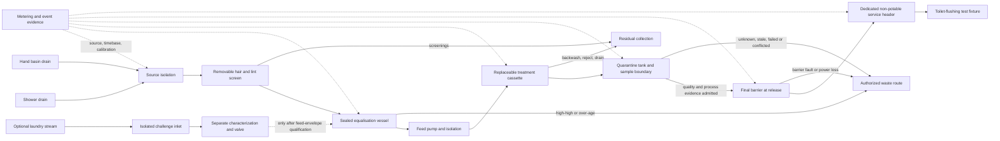

# WaterLoop Modular Residential Reuse Platform — Preliminary Design Package v0.1

**Workstream:** [WATERLOOP-MODULAR-001 #5784](https://github.com/Luminous-Dynamics/symtropy/issues/5784)  
**Parent evidence:** WaterLoop continuity/economics PRs #5368 and #5429  
**Design status:** concept/preliminary design only; not installation-ready  
**First demonstrator:** unoccupied test cell, shower + hand-basin light greywater, toilet-flushing use profile  
**Potable-use status:** explicitly out of scope

## 1. Executive design decision

Build a **common hydraulic/service chassis with replaceable, independently tested process cassettes**. Do not freeze a single treatment recipe as the product.

The platform has six physical zones:

1. Source isolation and screening.
2. Equalisation / feed conditioning.
3. Interchangeable treatment cassette.
4. Treated-water quarantine and sampling.
5. Final barrier / release and dedicated non-potable distribution.
6. Residual collection and maintenance access.

The first cassette for the test-cell programme is a **screen + depth/slow-sand prefilter + ultrafiltration + UV candidate** (Train A), because the 29 October 2026 bench comparison reports stronger microbiological consistency for that configuration than its ozone/GAC alternative. This is a *test-ordering decision*, not a declaration that Train A is safer, better, or validated in the field. Train B remains a comparator; ozone is excluded from the first mechanical build until a separate off-gas, exposure, residual-destruction and materials safety case exists.

A nature-based cassette is a third, site-dependent comparator, not a drop-in assumption: footprint, climate, loading, operator work and residual pathways must be counted.

**No treatment outlet is released based on cassette identity, turbidity, UV lamp-on state, or a software Boolean alone.** Use-specific release is an independent Mycelix #6100 evidence decision backed by an appropriate sampling/measurement and validated process control plan.

## 2. Research-derived design constraints

The September 2026 systematic review of 131 empirical greywater studies reports broad feed variability: COD 100–2,000 mg/L, TSS 30–1,000 mg/L, and laundry surfactants often exceeding 100 mg/L. It identifies household behaviour, source mixing, temporal variability and storage transformations as major treatment feasibility drivers. This justifies source separation, a measured feed envelope, and test matrices across variable source loads rather than a single representative synthetic mix. DOI: https://doi.org/10.1007/s42452-026-09559-0

The 29 October 2026 residential light-greywater bench study compared:
- **GWTT1:** sedimentation → slow sand filtration → UF → UV; 95.9% turbidity and 71.9% COD reduction; total coliform and E. coli reductions of 91% and 96%, respectively.
- **GWTT2:** sedimentation → ozone → GAC → UV; 99.6% turbidity and 78% COD reduction; 7% increase in heterotrophic bacteria associated with biofilm detachment.

The feed was a synthetic mixture and there were four sampling events; data are available on request. These results identify trade-offs, not a universal ranking. DOI: https://doi.org/10.1111/1752-1688.70162

ISO 18998:2026 covers management of decentralized reuse systems end-to-end (source, treatment, storage, distribution, O&M, monitoring, end use and sludge/residuals), but it expressly does not set monitoring parameter limits or regulatory values. NSF/ANSI 350-2026 is a relevant conformity/test-design comparator for onsite residential/commercial reuse treatment; applicability/class and exact requirements need review by the conformity assessor. South African GN 6292 Regulation 12 addresses water-services institutions reusing greywater beyond household boundaries and points to the WRC 2018 greywater guidelines.

References:
- https://doi.org/10.1007/s42452-026-09559-0
- https://doi.org/10.1111/1752-1688.70162
- https://www.iso.org/standard/85697.html
- https://www.nsf.org/knowledge-library/nsf-ansi-standard-350-certification-water-reuse-treatment-systems
- https://www.gov.za/sites/default/files/gcis_document/202506/52814gon6292.pdf

## 3. Functional process flow

This is a functional block diagram, not a piping-and-instrumentation drawing approved for construction. Every flow arrow must be reconciled in the detailed P&ID.

## 4. Detailed physical zoning and design basis

### Z-01 — Source separation and capture

**Included in first demonstrator:** shower and hand-basin streams only. Keep streams separately metered upstream of any mixing so source characteristics remain observable.

**Excluded:** WC/blackwater, kitchen/grease, workshop/industrial water, and laundry. Laundry receives a capped, isolated challenge connection for later tests; it does not connect to the normal feed unless a separately approved operating envelope exists.

Provide accessible coarse screens / hair-lint basket. Screenings drain to a closed residual container; no manual handling of wet screenings in an occupied area.

### Z-02 — Equalisation

Use an opaque, sealed, drainable vessel with a removable access cover, level measurement, temperature measurement, high/high-high protection, an engineered overflow to an authorized waste route, and a fully drainable sump/heel measurement.

Do not invent a universal raw-greywater storage-life. The permitted residence-time envelope must be experimentally established against the source, temperature and microbiological behaviour. An expired or uncharacterized batch is diverted and receives no reuse credit.

Mixing and ventilation must be designed to avoid aerosol generation and odour migration. Vessel venting is to an approved safe location; it is not a room air outlet.

### Z-03 — Cassette bay and fluid interface

The chassis provides a dry service bay separated from the wet zone by a bund/leak tray. Each cassette is mechanically keyed and carries a unique module ID and revision.

**Proposed interface contract:**
- separate feed, treated outlet, reject/backwash and drain ports;
- two independent isolation points for feed and treated outlet;
- sample ports at cassette inlet and outlet;
- pressure and differential-pressure measurement ports where pressure filtration is used;
- metered electrical feed and module-state connector;
- no shared undocumented internal bypass;
- quick disconnect only where its material compatibility, dead volume, leak integrity and accidental misconnection resistance are demonstrated;
- physically incompatible or keyed connectors for feed, accepted product and reject streams.

A cassette must publish its tested feed envelope, output envelope, max/min flow, allowable pressure, cleaning and replacement instructions, residual routes, electrical load, service tasks, alarms and known failure modes. Cassette identity is not quality evidence.

### Candidate A — filtration / UF / UV

Conceptual sequence: staged screen → settling/depth/slow-sand prefilter → UF → quarantine → final UV barrier at point of release.

UF integrity, differential pressure, flux, fouling, cleaning and reject flow must be measured. UV electrical state alone does not demonstrate delivered UV dose or microbial reduction; intensity, flow, UVT, sleeve condition, lamp age and validated reactor hydraulics matter. Independent outlet sampling remains required.

### Candidate B — ozone / GAC / UV

Kept as a separate comparator. No ozone component is built into the first chassis until a qualified engineer defines ozone generation, contactor, residual destruction, off-gas, exposure controls, interlocks, ventilation, compatible materials and emergency shutdown. GAC maturation and biofilm detachment require explicit monitoring and cleaning/replacement criteria.

### Candidate C — nature-based / biological

A site/landscape comparator: separate outdoor or pilot skid with defined footprint and hydraulic retention. Do not squeeze a wetland/biological process into the cassette footprint and claim equivalence. Count land, media, plant establishment, seasonality, mosquito/vector management, maintenance and solids/residual pathways.

### Z-04 — Quarantine and accepted-water storage

After cassette treatment, water enters a **quarantine / hold vessel**. It is not available to end use until a defined evidence package supports the declared use and the batch falls within the approved holding-time envelope.

The accepted-water vessel is opaque, sealed, drainable, cleanable and sized only after source-yield and toilet-demand traces are measured. Monitor level, temperature, turnover and inlet/outlet volume. Avoid dead legs and stagnant zones. Define tank cleaning, sampling and requalification.

### Z-05 — Final barrier and non-potable outlet

Place the final release barrier at the accepted-water withdrawal boundary in the pilot architecture. This makes post-storage microbial change visible and lets the outlet sample represent the water actually supplied to the use fixture.

The first endpoint is one instrumented toilet-flushing fixture. Measure fixture-boundary pressure/flow and volume. Any irrigation endpoint is a separate circuit and a separate use-specific quality admission.

### Z-06 — Potable backup and cross-connection exclusion

There is **no direct interconnection** between the reclaimed-water header and potable distribution. Any potable make-up, if required for a future approved installation, is through an engineered physical air gap / break tank and approved backflow protection, reviewed against applicable local requirements. A software-controlled valve is not accepted as the only barrier.

On treatment fault, the reuse system isolates. It does not automatically send raw or unqualified product to a fixture. Any independent building fallback is outside this module and must remain code-compliant without creating a cross-connection.

### Z-07 — Residuals and waste

Measure and label separately:
- screen solids;
- equalisation cleanout sediment;
- UF backwash/concentrate;
- GAC or media replacement;
- UV lamps and electrical components at end of life;
- cleaning/CIP water;
- overflow and failed batches.

Residual material is not fertilizer, compost, nutrient product or safe disposal material until independently assessed and accepted for a named route.

## 5. Preliminary control state machine

| State | Entry condition | Allowed output | Exit condition |
|---|---|---|---|
| Isolated | startup, maintenance, controller fault, critical sensor fault | none | manual inspection and permissives |
| Feed qualification | valid source ID, valid batch timestamp, level and age within defined envelope | feed to treatment only | approved feed envelope satisfied |
| Treating | module identified, isolation proof, flow/pressure/power in envelope | cassette outlet to quarantine only | treatment cycle and process evidence complete |
| Quarantine | batch isolated pending sample/quality/process assessment | no end-use delivery | independent release decision |
| Released | approved use-specific evidence and holding-time envelope | through final barrier to declared endpoint | expiry, new fault, stale evidence or empty |
| Divert | over-age, unknown feed, overflow, failed barrier, quality fail, power loss | authorized waste route only | fault resolved and batch cleared |
| Service | lockout/isolation/maintenance | none | documented service close-out and requalification |

This table is a design contract, not existing implemented controller software. Safety functions require physical design review and failure testing.

## 6. Preliminary tag list (to be resolved in P&ID)

| Tag | Function | Boundary / purpose |
|---|---|---|
| XV-101A/B | Shower/basin source isolation | source entry |
| STR-101 | Removable hair/lint screen | source protection |
| V-101 | Equalisation vessel | raw feed / level-volume |
| LT-101 | Level transmitter | inventory |
| TT-101 | Temperature sensor | residence time / condition |
| LSHH-101 | Independent high-high cutout | overflow prevention |
| P-101 | Feed pump | cassette feed |
| FIT-101/102 | Separate source and combined feed meters | source and feed reconciliation |
| PIT-201 | Cassette inlet pressure | module envelope |
| PDT-201 | Cassette differential pressure | fouling / integrity indicator |
| FIT-201/202 | Cassette feed and product meters | stage recovery |
| FIT-203 | Reject/backwash meter | residual closure |
| E-201 | Module energy meter | kWh/useful m³ |
| V-301 | Quarantine vessel | batch hold |
| SP-301A/B | Sample ports | feed/outlet qualification |
| V-302 | Accepted-water vessel | clean storage |
| LT-302 / TT-302 | Level / temperature | turnover |
| UV-401 | Final barrier (candidate) | final disinfection |
| FIT-401 / PIT-401 | Fixture flow / pressure | end-use delivery |
| XV-401 | Reclaimed distribution isolation | safe output isolation |
| FIT-501 | Residual/waste totalizer | one-water accounting |

Tag numbering and instrument choice are preliminary. Mycelix owns exact channel schemas, capability passports, uncertainty and calibration admission.

## 7. First demonstrator configuration and test plan

**Configuration A0 (test-cell proposal):**
- separate shower/basin feed containers with measured synthetic recipe inputs;
- removable screen;
- equalisation vessel with level, temperature and batch-age tracking;
- instrumented feed pump;
- cassette A mock-up / vendor-independent interface;
- quarantine vessel and sample points;
- accepted-water vessel;
- final UV module only after its reactor is independently specified;
- one instrumented toilet-flush demand fixture;
- separately measured reject, overflow and cleanout collection.

Do not set final tank volume, membrane area, pump duty, UV rating or nominal daily output before the source-yield/demand trace and module pressure-flow envelope are measured. The first build objective is to establish the interfaces and measurements, not to fabricate around guessed capacities.

### Test matrix

| Test family | Challenge | Required record |
|---|---|---|
| Feed variability | low/median/high COD/TSS recipes; source-specific detergent/surfactant | feed sample + batch identity |
| Load profile | pulse, batch, peak and intermittent draw | flow/time/level trace |
| Storage | controlled age and temperature series | quality/time change |
| Screen fault | progressive lint/hair blockage | differential head / flow / service time |
| Pump fault | loss of prime, dry run, power loss | isolation and safe-state trace |
| UF fault (A) | fouling, pressure excursion, integrity challenge | inlet/outlet, reject, pressure, cleaning log |
| UV fault | lamp/dose/flow invalid | outlet isolation proof |
| Outlet quality failure | sample fails declared use criterion | quarantine / no-release evidence |
| Controller fault | sensor stale, lost communication, restart | physical safe state and event log |
| Residual closure | screen, cleanout, reject, cleaning water | mass/volume ledger within uncertainty |
| Serviceability | remove/reinstall cassette and replace consumables | technician minutes, tools, spill and error log |

The initial 30-day per-configuration run is a screening target only; a final qualification horizon must be based on process cycle, feed seasonality and required standard/regulatory test programme.

## 8. Preliminary BOM / make-buy architecture

**No part numbers or purchasing selections are frozen.** Choose wetted materials only after feed chemistry, cleaning chemicals, pressure, temperature, UV exposure and local approvals are specified.

| Qty | Assembly | Make/buy strategy | Selection gate |
|---:|---|---|---|
| 1 | Modular structural chassis + bund | local fabricated frame | load, corrosion, access and containment review |
| 1 | Equalisation vessel | certified/compatible bought-in vessel or designed tank | usable volume and material compatibility |
| 1 | Removable screen basket | commodity/serviceable fabricated part | mesh/open area vs clogging/service test |
| 1 | Feed pump set | bought-in industrial component | pump curve, solids tolerance, noise, energy, dry-run |
| 1 | Cassette A mount/ports | open mechanical interface | serviceability, keyed connections and leak test |
| 1 | Treatment cassette A | prototype with qualified process engineer | feed envelope, quality and residual performance |
| 1 | Quarantine vessel | compatible bought-in/fabricated vessel | batch volume and sampling plan |
| 1 | Accepted-water vessel | compatible bought-in/fabricated vessel | turnover, cleanability and usable heel |
| 1 | Final barrier skid | bought-in module / independent design | validated dose/throughput/materials |
| 1 | Non-potable distribution test loop | standard approved plumbing components | code review, pressure/flow and cross-connection exclusion |
| 1 set | Flow/pressure/level/temperature/energy instrumentation | bought-in, Mycelix-admitted | calibration, range, uncertainty and data interface |
| 1 set | Isolation valves, drains, sampling and check devices | standard components | fail state, material and reviewer approval |
| 1 set | Controller/data logger for test cell | platform instrumentation | safe outputs default to isolate; no autonomous household control |

A local fabrication package should be released only after the P&ID, hazard review, materials selection and module ICD are approved by competent reviewers.

## 9. Acceptance criteria for design freeze

A0 design may progress to detailed drawing only after:
1. source and outlet use profiles are explicit;
2. source exclusion and potable/non-potable segregation are independently reviewed;
3. all flow paths, bypasses, overflows, vents and residuals have an authorized destination;
4. every critical failure state has a physical safe state and test procedure;
5. expected feed, demand, pressure and volume envelopes are derived from measured/specified inputs;
6. component compatibility, access, maintenance and replacement assumptions are documented;
7. P&ID, electrical single-line, FMEA and BOM are cross-reconciled;
8. Mycelix instrument/quality evidence boundaries are referenced, not copied;
9. local engineering reviewer sign-off is obtained.

## 10. Performance targets (future evidence only)

- Zero release of unqualified/off-specification water in seeded fault trials.
- 100% isolation/diversion on loss of critical process evidence.
- At least 95% scheduled service availability inside a declared, independently validated feed/ambient envelope.
- 100% water-path reconciliation within combined measurement uncertainty.
- Energy target below 1.0 kWh per verified useful m³ for the complete residential light-greywater system, only as a stretch objective and never compared against a different treatment boundary.
- 30% fewer technician minutes per 1,000 useful m³ versus a matched commercial appliance, on an identical service-task boundary.
- Lifecycle cost per useful m³ lower than matched commercial/nature-based comparator without lowering quality protection or shifting residual/labour burdens.

These are not achieved results, standard limits, or universal household design criteria.

## 11. Open decisions that block sizing, not concept progress

- Measured source-yield/demand trace by fixture and occupancy profile.
- Intended-use quality criteria and authority for toilet-flushing reuse in the demonstrator jurisdiction.
- Maximum allowable raw-feed residence time by source/temperature.
- Cassette A hydraulic envelope and UF cleaning/reject strategy.
- Final barrier specification and monitoring/validation evidence.
- Storage volume after demand and turnover analysis.
- Permitted overflow, waste, backwash and cleaning-water destinations.
- Materials compatibility and serviceability.
- Local code and professional review.

## 12. Design nonclaims

This package is preliminary and is **not** a construction P&ID, certified design, bill of materials for procurement, process guarantee, potable system, safe reuse certification, SANS/NSF/ISO conformity evidence, or approval for an occupied dwelling.