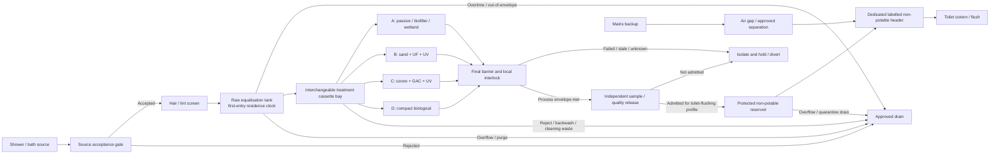

# WaterLoop Modular Greywater Treatment Architecture v0.1

**Date:** 16 November 2026  
**Parent:** [WATERLOOP-MODULAR-TRAIN-001 #5475](https://github.com/Luminous-Dynamics/symtropy/issues/5475)  
**Design state:** research reference architecture; no hardware selected or qualified  
**Evidence ceiling:** literature/vendor comparison + synthetic interface specification  
**Primary V0 profile:** separately collected shower/bath light greywater → non-potable toilet flushing (subject to local risk/quality assessment)

## 1. Design thesis

Build a **source-aware modular water-service platform**, not a universal greywater appliance.

Its advantage must come from the integrated service:
- source stream identity and admission;
- short, controlled raw-water residence;
- modular process cassettes selected against measured influent properties;
- independent quality admission for the intended end use;
- physical non-potable distribution separation;
- automatic safe diversion/isolation on loss of evidence or process capability;
- repairable modules and full-boundary lifecycle accounting.

A higher COD or turbidity removal percentage alone is not a product win. The winning architecture must deliver more use-qualified water for less energy, labour, cost and risk over time, under matched source and demand conditions.

## 2. What current evidence says

### Greywater is not one stable feed

Ninsiima et al. (23 September 2026) reviewed 131 empirical studies from 2016–2026. Across those studies COD ranged 100–2,000 mg/L, TSS 30–1,000 mg/L, laundry anionic surfactants frequently exceeded 100 mg/L, and microbial indicators commonly exceeded reuse thresholds. The review identifies source mixing, household behaviour, temporal variability and storage transformation as major drivers of fouling, treatment performance, maintenance, energy and health risk.

Source: https://doi.org/10.1007/s42452-026-09559-0

**Engineering consequence:** freeze V0 as shower/bath only. Treat laundry as a separate, higher-variability future profile. Do not combine streams and then assume one average influent represents the actual household.

### Different process trains win on different outcomes

García-Agudelo et al. (first published 29 October 2026) compared two bench-scale treatment trains using synthetic residential light greywater:
- Train 1: sedimentation → slow sand → ultrafiltration → UV.
- Train 2: sedimentation → ozone → GAC → UV.

Train 2 reported greater turbidity/COD removal (99.6% / 78% versus 95.9% / 71.9%), while Train 1 showed stronger microbial indicator reduction in that experiment (total coliform 91%, E. coli 96%). Train 2 reported a 7% increase in heterotrophic bacteria associated with biofilm detachment. The experiment is bench-scale with synthetic feed; it is not a long-duration household proof.

Source: https://doi.org/10.1111/1752-1688.70162

**Engineering consequence:** assess organic removal, microbial control, regrowth, by-products, fouling and maintenance as separate dimensions. Never infer microbial safety from COD or turbidity performance.

### Nature-based treatment is a serious comparator, not decoration

Morandi & Steinmetz (August 2026) review constructed wetlands for greywater. They identify stream-specific pretreatment to reduce TSS/clogging, benefits from multi-stage hybrid wetlands, and the need for post-disinfection where reuse risk/quality requires it.

Source: https://doi.org/10.1016/j.coesh.2026.100737

**Engineering consequence:** keep a passive biofilter / wetland reference in the benchmark, but count land area, seasonal conditions, hydraulic residence, maintenance, pathogen risk and final disinfection. Low energy per m³ alone does not qualify a system.

### South African design constraints

The WRC's TT 746/17 greywater guidelines favour lower-risk warm-up/rinse/bath/shower sources; advise against direct contact; exclude higher-risk sources/conditions such as kitchen wastewater, faeces-contaminated laundry, animal wash, chemical-cleaning streams and use during household illness; and state untreated greywater should not be stored longer than 24 hours. They also flag sodium/soil issues where irrigation is considered.

Reference summary: https://www.wrc.org.za/wp-content/uploads/mdocs/WW%20Sept-Oct%202018_Water%20reuse.pdf

The 24-hour point is an outer guideline limit, not a desired design holding time. V0 should timestamp the first entry to untreated storage and test much shorter dwell windows (0, 6, 12, 18, 24 hours) rather than rely on a daily batch assumption.

## 3. Product boundary and V0 use profile

**V0 collection:** shower and bath only, dedicated gravity-drained and vented pipework.

**V0 intended use:** toilet flushing only, after treatment and independent admission of the required water-quality/use criteria.

**Excluded in V0:** kitchen sink/dishwasher, toilet/bidet/urinal, floor drains, laundry, nappy/faeces-contaminated textiles, animal washing, workshop/vehicle/paint/solvent sources, chemical-cleaning discharge and any source rejected by the local operating protocol.

No reuse for drinking, cooking, bathing, showering, food washing, aerosol-generating humidification or edible-crop irrigation. Additional uses require a separate risk assessment, quality target, plumbing boundary and qualification.

## 4. Functional architecture

`SOURCE -> ACCEPT / DIVERT -> SCREEN -> EQUALISE -> TREATMENT CASSETTE -> FINAL BARRIER (if required) -> PRODUCT HOLD -> QUALITY RELEASE -> NON-POTABLE USE`

Every point has a reject or safe route:
- source rejected → approved drain;
- raw-water residence exceeded → approved drain;
- process out of envelope → isolate product outlet and divert;
- final-barrier status unknown/failed → quarantine product batch, no release;
- product sample not admitted → no quality claim and no release for the named intended use;
- power/instrument/control loss → local fail-safe isolation and approved drain/bypass;
- product tank high level → overflow to approved drain with separately measured path;
- maintenance overdue → inhibit release until the declared restart checks pass.

**No direct potable cross-connection.** Mains backup to non-potable service must be designed as an air-gapped or otherwise approved, professionally reviewed separation arrangement. Dedicated, permanently labelled non-potable pipework and outlets are required. Cross-connection testing is part of commissioning and recurring inspection.

Safety and physical isolation must work with no internet, no cloud, no Symthaea/Mycelix availability and no AI inference. Digital components may report, diagnose and produce evidence; they do not replace local hardwired protections, manual isolation or qualified operator judgement.

### PFD-level service boundary

The four cassette blocks are **alternatives**, not sequential treatment stages in one fixed train. The final-barrier and independent sample-release gates depend on the validated use profile. The mains line terminates through an approved physical separation into the non-potable service arrangement; it is not a cross-connection to the treated-water line.

## 5. V0 physical modules and interface contract

| Module | Required interface | Key failure / acceptance condition |
|---|---|---|
| M0 source header | Dedicated shower/bath drains, gravity, vent, isolation, source label | Wrong-source connection or unknown source → reject/divert |
| M1 screen | Accessible hair/lint basket, removable without opening downstream vessels | Blockage visible; overflow cannot reach product line |
| M2 equalisation | Opaque drainable tank, level, temperature, timed residence, sampling point, overflow | Residence clock starts at first raw-water entry; exceedance → drain |
| M3 cassette bay | Standardised inlet/outlet, unions, isolation, sampling points, module identity | Wrong module/revision or out-of-envelope feed → no release |
| M4 final barrier | Process status, validated operating envelope, independent sample points | Barrier failure/stale evidence → fail closed |
| M5 product reservoir | Opaque, covered, drainable, cleanable, level and sampling | Unknown batch status or contamination → quarantine/drain |
| M6 distribution | Dedicated non-potable piping, labelled outlets, pressure/flow boundary | Cross-connection / backflow test failure → no commissioning |
| M7 backup supply | Independent mains supply through approved separation/air gap | Any direct cross-connection prohibited |
| M8 waste/residuals | Measured reject, purge, backwash/CIP and overflow routes | Unaccounted residual stream blocks closure |
| M9 power/safety | Local isolated power, manual stop, hardwired interlocks, fault log | Loss of power/control → reclaimed outlet isolated |

Every cassette must declare: ID/revision, materials, dimensions/mass, connector standard, pressure/temperature envelope, permitted source profile, feed-property envelope, hydraulic loading and HRT/EBCT, energy and chemical duty, sample points, residuals, cleaning, replacement, failure states, safe bypass, restart criteria, footprint, noise, ventilation, service skills and evidence status.

## 6. Candidate trains — run side-by-side, do not prematurely select

### A. Passive / nature-based reference
Screening → settling → staged sand/media or compact biofilter → optional multi-stage planted wetland where space and site permit → final disinfection only if required by the qualified use profile.

Advantages to test: low energy, locally serviceable media, simple mechanical elements.  
Risks to measure: land/footprint, clogging, slow start-up, seasonal performance, microbial persistence and maintenance labour.

### B. Sand + UF + UV
Screening/settling → graded sand/media pretreatment → replaceable UF module → UV barrier.

Measure: flux, TMP, integrity, fouling rate, cleaning recovery, retentate/reject volume, UV delivered-dose envelope and downstream regrowth. UV is not inferred effective merely because a lamp is powered.

### C. Ozone + GAC + UV
Screening/settling → ozone contactor with off-gas destruction → GAC cassette → UV.

Measure: ozone transfer/dose, off-gas, by-products, GAC breakthrough, biofilm/regrowth, contact time and energy. Ozone handling requires specialist hazard controls and is not a default household option.

### D. Compact biological / biofilm train
Screening/settling → aerobic biofilm/MBBR or SBR → clarification/solids capture → optional tertiary filtration/disinfection.

Measure: start-up, biological stability, load shocks, aeration energy, sludge/solids, odour, maintenance and power-loss recovery.

No train is preselected. A train is acceptable only within an explicitly tested feed and reuse envelope.

## 7. Instrumentation and data boundaries

Process-control sensors may include tank level, flow, differential pressure, temperature, pH, conductivity, turbidity, membrane TMP/flux, UV intensity/status, ozone-related process controls and pump electricity. Each instrument's measurand, range, calibration, uncertainty, response, installation point and timestamp must be admitted through Mycelix.

These sensors are not all quality tests. In particular:
- turbidity does not prove pathogen removal;
- conductivity does not identify every dissolved contaminant;
- ORP does not prove oxidation by-product safety;
- UV lamp power/status does not alone prove delivered microbial dose;
- a model or sensor fusion score does not replace laboratory measurement.

Raw influent and effluent samples must be independently identified and analysed by methods appropriate to the named reuse and the local risk plan. Use-specific quality admission belongs to Mycelix #6100, not this controller or the Symtropy process model.

## 8. Matched test plan

Use one frozen, homogenised influent batch split across all candidate trains for each paired comparison. Preserve batch ID, source class, collection time, storage history, temperature and sample chain of custody. Synthetic feed is useful for repeatable screening; actual local shower/bath water is required before performance can be claimed for local operation.

Challenge dimensions:
- source variability and surfactant/personal-care pulses;
- COD/TSS/turbidity range, with matrix values frozen by the lab;
- variable temperature;
- intermittent and sustained loading;
- wrong-source mixing negative control;
- raw residence time (0, 6, 12, 18, 24 h);
- idle/start-up/restart and biological maturation;
- power outage and pump loss;
- media loading, membrane flux decline, breakthrough and cleaning recovery;
- sensor stale/missing/conflicted;
- final-barrier failure and post-treatment storage/regrowth;
- maintenance overdue and spare-part substitution.

Run an unoccupied test cell; no human exposure trial is in scope. Freeze the sampling plan, analytical methods and safety gates before trial execution.

## 9. Scorecard: the comparison that matters

Report each dimension separately by treatment train, source profile, operating cycle and reuse class:
- admitted feed envelope and excursions;
- effluent quality and independent microbial evidence;
- useful product water delivered to the named end-use boundary;
- rejected/purged/backwashed/overflow volume and residual destination;
- recovery ratio and water mass-balance closure;
- kWh per verified useful m³ including standby, controls and auxiliaries;
- chemical/consumable use and replacement interval;
- fouling, pressure loss, flux decay and post-clean recovery;
- availability, failed-release count and safe-state time;
- maintenance interventions/hours and local spare-part lead time;
- footprint, noise, handling mass and embodied/replacement burden;
- cost per useful m³ and actual utility bill delta;
- service continuity during power/source outages.

Stretch objectives after a physical baseline is established:
- 100% seeded critical faults isolate the reclaimed outlet;
- 100% wrong-source/over-residence tests are diverted before product release;
- zero use-quality credit without admitted lab evidence;
- all material water/energy/residual paths reconcile within the predeclared uncertainty model;
- ≥95% useful-water availability within the declared and tested duty envelope;
- ≥20% lower full-boundary energy **or** lifecycle cost than the best matched incumbent, without worse quality, safety, critical service or maintenance burden.

The last two are research targets, not claimed performance. There is no universal effluent number here: the applicable quality criteria must be set by qualified professionals for a specific end use before a trial.

## 10. Industry comparator: Hydraloop H300/H600

The manufacturer's June 2026 installation manual specifies:
- H300: 100 L nominal volume, 360 L/day nominal treatment capacity, 280 kWh/year average energy, pump 2.4 bar / maximum 8 L/min;
- H600: 200 L, 720 L/day, 450 kWh/year;
- shower/bath greywater sources and mains backup;
- indoor-only, 14–35 °C, relative humidity below 70%, with UV/IP rating listed as not rated;
- dedicated gravity-drained, vented greywater collection, overhead bypass, and exclusion of kitchen drains, dishwashers, floor drains and human-waste sources.

Manual (June 2026, v1.0): https://static1.squarespace.com/static/6809d6b186796545157fbf2f/t/6a55b27199175d688f397fb5/1784001140399/Hydraloop%2Binstallation%2Bmanual%2B-%2BJuly-2026.pdf

At H300's full nameplate throughput, 280 kWh/year ÷ (0.36 m³/day × 365) = **2.13 kWh per nominal m³**. This is not actual measured energy per useful product-water m³. WaterLoop must measure actual duty, backup use, reject, standby and accepted end-use volume over the same boundary.

The product manual is a serious engineering baseline. The proposed differentiation is source acceptance and shorter residence control, process cassette interchangeability, independent quality-release evidence, repairable local service, no-cloud safe state and complete verified useful-water economics—not simply claiming more treatment stages.

## 11. Deliverables and ownership handoff

- This architecture document and the machine-readable source/module/test manifests.
- #5335 owns P&ID and demonstrator physical integration.
- #4902 owns complete sanitation chain and residual treatment boundaries.
- #6100 owns quality method/sample assessment and use-specific admission.
- #6034/#6029/#6048/#6054/#6057 own instrument/uncertainty/timebase admission.
- #5364/#5368 own household water service continuity outcomes.
- #5425/#5429 own water-system cost per verified useful service.
- #2152 owns mass/energy/residual closure.
- #4963 owns leak and service-restoration verification.

## 12. Nonclaims

This architecture does not qualify a treatment train, pathogen removal, potable water, reuse safety, regulatory compliance, household savings, commercial readiness or product superiority. It authorizes no installation, purchase, construction or human exposure. Qualified plumbing/electrical/water-quality review and an approved unoccupied demonstrator protocol are prerequisites to physical testing.
