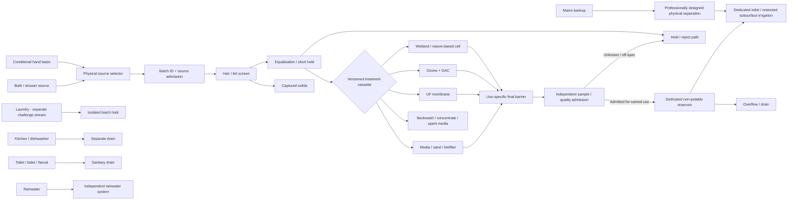

# WaterLoop Modular Treatment Architecture v0.1

**Date:** 16 November 2026  
**Parent:** [WATERLOOP-MODULAR-001 #5502](https://github.com/Luminous-Dynamics/symtropy/issues/5502)  
**Architecture contract:** `waterloop-modular-architecture-v0.1.json`  
**Evidence class:** design reference only  
**Qualification:** `NotRun`

## 1. Product concept

WaterLoop should not be designed as one fixed greywater appliance. It should be designed as a compact, serviceable platform with a stable interface and process cassettes that can be selected after the source and end use are characterized.

The platform is made of seven independently reviewable subsystems:

1. Source manifolds and physical source segregation.
2. Raw feed batch identity, screening and equalisation.
3. Interchangeable treatment module(s).
4. Use-specific final treatment/disinfection where required.
5. Dedicated non-potable treated-water buffer and distribution.
6. Mains backup isolation and fail-safe interlocks.
7. Reject, backwash, spent media and other residual handling.

The machine-readable contract defines 10 candidate modules and four candidate train families. It is an architecture and test contract, not a bill of materials or approved P&ID.

## 2. Why source-aware modularity beats a universal treatment train

The September 2026 review of 131 greywater studies reports large influent variation: COD 100–2,000 mg/L, TSS 30–1,000 mg/L and laundry surfactants frequently above 100 mg/L. It identifies source mixing, household behaviour, time variation and storage transformations as major causes of fouling, performance variability, maintenance burden and risk. Therefore "greywater" is not a single reproducible feedstock.

The 29 October 2026 bench comparison is instructive because it did **not** identify one universally superior process:
- ozone/GAC gave higher turbidity/COD removal on its synthetic feed;
- the authors also report GAC biofilm detachment associated with a 7% heterotrophic-bacteria increase;
- UF+UV had more consistent microbiological control in their experiment, including reported 91% total-coliform and 96% E. coli reductions.

Those findings are from a bench-scale synthetic feed and are not comparable to a field installation or independent certification. The correct design lesson is to preserve multiple candidate process modules and use a matched source-specific qualification programme.

Sources:
- Ninsiima et al. (published 23 September 2026), *A systematic review of greywater properties and variability that govern decentralised off-grid treatment feasibility*: https://doi.org/10.1007/s42452-026-09559-0
- García-Agudelo et al. (first published 29 October 2026), *Comparative Analysis of Integrated Treatment Trains for Residential Light Graywater Reclamation*: https://doi.org/10.1111/1752-1688.70162
- Morandi & Steinmetz (August 2026), *Constructed wetlands for greywater treatment: a review*: https://doi.org/10.1016/j.coesh.2026.100737

## 3. Candidate block diagram

This is a functional topology. Pipe sizes, pump duty, tank volume, hydraulic grade, treatment loading and disinfection setpoints are intentionally unassigned until a design basis and professional review exist.

Important: the diagram shows alternatives, not an instruction to connect every process branch. The Mains Backup branch must be independently engineered so that reclaimed water cannot contaminate the potable system. Any drain, reject or overflow route needs a site-specific hydraulic and legal review.

## 4. Physical source policy

| Source | Initial policy | Reason / next evidence |
|---|---|---|
| Bath and shower | Candidate light-greywater stream | Characterize batch and household variability; not presumed clean or safe |
| Hand basin | Hold separate / conditional | Cleaning products, hand hygiene and other site-specific inputs |
| Laundry | Segregated challenge population | Surfactants/fibres/TSS and cycle-phase variation; do not blend by default |
| Kitchen / dishwasher | Exclude from initial reference train | Grease, food solids and cleaning chemistry need a separate design |
| Toilet / bidet / faecal flows | Exclude | Not greywater |
| Paint, chemical, machinery/vehicle or animal washing | Exclude | Separate source/risk and waste route |
| Rainwater/stormwater | Separate system | Different first-flush, catchment and microbial/chemical risk |
| Mains backup | Physically separated | Prevent cross-connection/backflow; local approved design |

The WRC 2018 guidance summarized in a 2018 Water Wheel article advises against storing untreated greywater longer than 24 hours and excludes numerous high-risk sources. Treat that as a design-review trigger; the full primary guideline and site-specific applicable requirements must be reviewed before a design decision. Source summary: https://www.wrc.org.za/wp-content/uploads/mdocs/WW_Sept-Oct2018_web.pdf

South Africa's 2025 compulsory water and sanitation standards, Regulation 12, addresses a Water Services Institution collecting/using greywater beyond a household boundary and requires risks to be managed in its wastewater risk-abatement plan, using WRC's 2018 guidelines to assist. Whether and how a given private or commercial installation falls within regulatory provisions requires local legal/technical review; this issue makes no blanket compliance conclusion: https://www.gov.za/sites/default/files/gcis_document/202506/52814gon6292.pdf

## 5. Treatment cassette design rules

### C1 — passive media

Candidate path: screened feed → media/sand/biofilter → polishing/disinfection only if required by the declared intended-use profile.

Measure loading, headloss, turbidity/TSS, COD/BOD where relevant, media exhaustion, cleaning frequency, microbial performance and bypass. A lower energy demand is not a safety pass.

### C2 — ultrafiltration

Candidate path: pretreated feed → UF → permeate/reject/backwash → use-specific downstream treatment.

Measure normalized flux, transmembrane pressure, integrity, backwash volumes, cleaning chemicals, membrane replacement, microbial reduction and recovery after a seeded integrity fault. Membrane integrity failure is a fail-closed barrier fault.

### C3 — ozone + GAC / biologically active carbon

Candidate path: pretreated feed → professionally engineered ozone contactor → GAC/BAC → downstream quality assessment and any required final barrier.

Measure applied dose, contact conditions, off-gas controls, residual ozone, carbon maturity/breakthrough, biofilm shedding, downstream microbial response and spent-carbon disposal. Do not treat "GAC matured and improved COD" as a safety claim.

### C4 — nature-based treatment

Candidate path: source-specific pretreatment → modular wetland/biological cell → polishing/disinfection only where the use-specific risk design requires it.

Measure land area, hydraulic loading, retention, short circuiting, TSS/clogging, seasonal temperature response, vector/odour control, vegetation/sludge maintenance and outlet quality distribution. Nature-based does not mean passive in labour or maintenance.

### C5 — final disinfection

UV is one candidate final barrier. UV does not create a persistent disinfectant residual in downstream storage. Therefore post-treatment storage residence, tank cleanliness, regrowth and outlet microbiology require separate evidence. A sensor reading of UV power/flow is not itself microbiological proof.

The modules are not freely composable. Each train revision needs engineering review for hydraulic compatibility, chemical interactions, residence time, pressure envelope, control interaction and typed residual outputs.

## 6. The safety architecture

A fail-safe design must not rely on one water-quality sensor. The control/assurance chain should bind:

`source/batch identity → module configuration → validated operating envelope → sample/method evidence → use-specific quality admission → permitted outlet service`

Any one of these critical evidence items being absent, stale, contradictory or invalid must prevent reuse credit and put the physical unit into its independently reviewed safe state.

Candidate states:
- `ISOLATED`: no reclaimed-water delivery;
- `RAW_HOLD`: batch retained only within validated residence limit;
- `TREATING`: a versioned process train is active and within its declared control envelope;
- `QUALITY_PENDING`: output isolated pending independent result;
- `ADMITTED_FOR_USE_X`: only the named use profile is eligible;
- `OFF_SPEC`: product isolated and routed to a reviewed reject/hold path;
- `FAULT_LATCHED`: fail-closed until cause is corrected and recovery evidence is accepted;
- `MAINTENANCE`: isolated, drained/secured as appropriate, with maintenance log and configuration change identity.

A fail-closed control architecture should preserve independently protected mains service. No controller or AI prediction should be able to override a missing laboratory result or physically failed barrier.

## 7. Plumbing and international test comparators

SANS 10252-1 includes cross-connection and backflow prevention provisions, hazard-appropriate protection and non-potable identification. The exact current edition, amendments and municipal requirements must be checked with SABS and relevant local authorities before design freeze. A publicly accessible copy of the 2018 edition is not a substitute for an authoritative current standard: https://www.mosselbay.gov.za/storage/documents/cb942e034d7e086691fa18d41a15b553.pdf

NSF/ANSI 350 is a useful international comparator for testing onsite residential and commercial reuse systems. NSF describes testing of design/construction/performance and treatment quality for intended non-potable end uses. It is not itself South African legal approval and does not replace local SANS, building, plumbing, public-health or municipal review:
- https://www.nsf.org/knowledge-library/nsf-ansi-standard-350-certification-water-reuse-treatment-systems
- https://www.nsf.org/consumer-resources/articles/onsite-water-reuse-treatment-systems

## 8. T0, T1 and T2 execution plan

### T0 — executable design-contract checks

Add deterministic cases to check:
- excluded source cannot enter a candidate greywater train;
- laundry source remains segregated;
- unknown source cannot be auto-admitted by a normal turbidity/conductivity value;
- every module has typed feed/product/reject/drain/sample and energy boundaries where applicable;
- module substitution increments whole-train configuration identity;
- UV alone cannot be represented as persistent downstream residual protection;
- an unadmitted sample cannot unlock use;
- membrane integrity, ozone interlock, power, sensor, overflow and blocked-reject faults close the reuse outlet;
- a cross-connection or unreviewed mains top-up topology is rejected;
- unaccounted residual output blocks a "resource-efficient" claim.

Inputs, manifest, oracle and schema must be separate. T0 remains synthetic and must not be described as a treatment validation.

### T1 — unoccupied skid

Construct a non-domestic, non-potable skid with:
- physically distinct source-batch tanks;
- removable coarse screen and equalisation vessel;
- standardized process-module ports;
- flow/pressure/temperature/level and electrical measurement at every required boundary;
- sample taps before and after each unit process;
- separately metered product, purge, reject, backwash and overflow;
- isolation, drain, leak containment, emergency stop, off-gas controls where required, and safe maintenance access;
- a protected reject path approved for the test facility.

Compare at least: passive media, UF, ozone/GAC and a nature-based unit operation where the facility/site is appropriate. Use matched aliquots and a predeclared test matrix. Do not run any human-contact or domestic-use trial.

### T2 — future site trial

A household trial is not part of T0 or T1. It requires, at minimum:
- an independently reviewed system design and site hazard assessment;
- qualified plumbing/electrical/process professionals;
- legal and municipal approval as applicable;
- source/use-quality sample programme through Mycelix #6100;
- commissioning, cross-connection and backflow testing;
- resident consent, maintenance capacity, incident response and monitoring;
- approved discharge/reject route.

## 9. Comparison scoreboard — no single weighted winner

| Dimension | What to compare | Proposed engineering ambition (not achieved) |
|---|---|---|
| Safety | Fault-injection fail-closed, off-spec false acceptance, cross-connection tests | 0 seeded unsafe-use false accepts; 100% critical-evidence fault fail-closed |
| Use service | Admitted useful m³, fixture pressure/flow, service interruptions | ≥95% in-envelope delivery on predeclared matched T1 profiles |
| Reliability | Fouling, media breakthrough, membrane integrity, restart and maintenance | Report distributions and confidence intervals; not only uptime mean |
| Energy | Metered kWh per admitted useful m³, including standby/backwash/auxiliaries | Beat matched alternatives only without worsening any safety/service criterion |
| Mains displacement | Actual use-qualified volume replacing mains at the declared use | Measure at the meter and fixture; do not infer from nameplate capacity |
| Residuals | Backwash, purge, reject, spent media/carbon, sludge | 100% typed and measured or explicitly unmeasured residuals |
| Maintainability | Routine maintenance minutes, spares, cleaning frequency, service downtime | Research target ≤30 min/month routine household maintenance after field evidence |
| Economics | Installed and lifecycle cost per verified useful m³ and critical person-day | Compare with #5425 at matched service, tariff and payer boundary |
| Modularity | Time and failure risk to replace a process cassette | Versioned interface; any module change invalidates/renews whole-train qualification |
| Transfer | Source/season/household generalisation | Separate source strata; do not pool bath, laundry and kitchen feed |

The safety floor is non-compensatory: no energy or cost saving can offset a false safe-pass, cross-connection or unqualified reuse.

## 10. Manufacturing design gates

Do not create a production BOM until T1 has frozen:
- design flow range and hydraulic profile;
- tank/material compatibility and cleanability;
- module dimensions, seals, fittings and pressure envelope;
- required sensors and calibration/service intervals;
- pump curve and duty only after the hydraulic requirement is calculated;
- electrical safety, isolation, ingress protection and environmental conditions;
- chemical/UV/ozone safety controls where relevant;
- replacement media/membrane/carbon supply chain;
- safe access, lift weight, drainability and maintenance time;
- rejection and backwash disposal;
- validated whole-train configuration and acceptance test.

Manufacturing should use common mechanical and electrical interfaces, but process media and components must remain segregated by module type. Design for serviceability: front-access consumables, captive spill containment, keyed connectors, explicit flow direction, no ambiguous hose ports, and configuration labels/QR receipts. These are design requirements to assess, not a released production specification.

## 11. Immediate execution backlog

1. Validate the JSON architecture contract with a strict schema and T0 invariant tests.
2. Draw the first candidate P&ID in the unoccupied bench boundary.
3. Freeze the sample/batch identity and module port data dictionary with Mycelix.
4. Select the bath/shower source profile first; keep laundry as a separate challenge branch.
5. Define the T1 matched-aliquot experiment and blind fault controls.
6. Build the skid only after instrumentation, drain/reject and professional safety reviews.
7. Produce the first BOM after the T1 process envelope is known.

## 12. Nonclaims

No process module, train, point-of-use quality, pathogen safety, drinking-water safety, household deployment, cost saving, energy advantage, product certification or manufacturing readiness is qualified by this architecture document.
