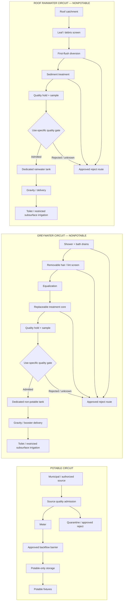

# WaterLoop Modular Reference Architecture v0.1

**Tracking:** [WATERLOOP-REFERENCE-ARCH-001 #5457](https://github.com/Luminous-Dynamics/symtropy/issues/5457)  
**Status:** design candidate; not site-approved or physically qualified  
**Evidence class:** design contract only  
**Architecture JSON:** `waterloop-reference-architecture-v0.1.json`  
**Schema:** `waterloop-reference-architecture-v0.1.schema.json`

## 1. Design thesis

WaterLoop is a source-separated water-service platform, not a single greywater appliance. Its design object is a typed network of sources, treatment modules, quality admission gates, storage, outlets, reject paths and maintenance interfaces. The architecture must be safe when power, communications, sensors, treatment or maintenance fail.

The first reference configuration has three physically distinct circuits:
1. **Potable circuit:** admitted municipal / authorized supplier / independently qualified drinking-water source only.
2. **Greywater circuit:** shower and bath feed only in the initial profile; treatment and release only for admitted non-potable uses.
3. **Roof-rainwater circuit:** roof runoff with debris and first-flush handling; independently treated and admitted for a declared non-potable use.

No v0.1 cross-feed, shared tank or software-controlled potable top-up is permitted. A future design that adds a mains makeup path must show the physical air gap/backflow arrangement and pass a separate plumbing cross-connection review.

## 2. System flow diagram

The three subgraphs are separate physical systems. The diagram intentionally contains no connection between potable and either non-potable circuit. The machine-readable graph is additionally checked by a Rust contract test for circuit identity, reachability through quality gates and fail-safe state transitions.

## 3. Source/use profiles and treatment-core selection

A 2026 systematic review of 131 empirical studies reports greywater COD of 100–2,000 mg/L and TSS of 30–1,000 mg/L across studies; laundry surfactants frequently exceeded 100 mg/L. The review identifies source mixing, household behaviour, temporal variability and storage transformations as drivers of fouling, maintenance, energy demand and health risk. This is why treatment selection must be based on the *distribution and extremes* of the admitted source profile, not a generic "greywater" label.

### Initial source admission profile

| Source | V0.1 admission | Reason / next qualification |
|---|---|---|
| Shower / bath | Candidate feed | Lower cross-contamination complexity than a mixed household drain; still contains body products, hair, skin and microbial load |
| Laundry | Excluded from initial profile | Separate challenge profile required for surfactant, detergent, bleach, temperature and lint effects |
| Kitchen sink / dishwasher | Excluded | Grease, food residues, high organic load and cleaning chemicals change pretreatment needs |
| Toilet / blackwater | Excluded | Belongs to the sanitation chain / #4902, not this greywater pilot |
| Roof runoff | Separate circuit | First flush, roof material, bird/faecal exposure and storage age require distinct admission |
| Borehole / groundwater | Separate source owner | Requires source rights, aquifer and drinking/non-potable quality evidence; no automatic potable credit |
| Municipal water | Potable circuit | Use the supplied utility's admitted drinking-water evidence and applicable protection |

### Treatment-core candidates

No candidate below is selected by this design pack. All must be tested against the same measured feed profile, intended use, hydraulic loading, temperature, monitoring window, residual route and maintenance boundary.

| Candidate core | Potential advantage | Principal constraints to benchmark |
|---|---|---|
| Attached-growth biofilter / biological media | Low operating energy and modular media candidates | Start-up, shock loading, temperature, biofilm stability, odour, pathogen control and media replacement |
| Slow sand / depth filtration + disinfection | Simple passive filtration candidate | Surface area, head loss, ripening, cleaning, microbial barrier and post-filter storage |
| UF / membrane + disinfection | Compact physical barrier candidate | Flux, fouling, integrity testing, backwash/cleaning, concentrate and energy |
| Ozone + GAC + UV | Oxidation/adsorption/polishing candidate | Ozone contact and off-gas safety, GAC exhaustion, by-products, UV transmittance and power |
| Nature-based wetland / compost / denitrification | Potential very low energy with nutrient/residual integration | Land, hydraulic retention, seasonal performance, bypasses, clogging, pathogen barrier and solids management |

A 29 October 2026 bench-scale comparison on a synthetic residential light-greywater feed compared sedimentation + slow sand + UF + UV with sedimentation + ozonation + GAC + UV. The latter reported higher organic removal on that feed, but neither train is thereby proven superior under real household influent or long-term operation. DOI: https://doi.org/10.1111/1752-1688.70162

A July 2026 multi-year nature-based study across one household and two school installations reported 0.05–0.17 kWh/m³. That is a valuable low-energy comparator, but the sewage feed, scale, land and use boundary differ from a shower-greywater appliance; no direct leaderboard comparison is justified without a matched trial. DOI: https://doi.org/10.1016/j.jenvman.2026.130241

## 4. P&ID interface schedule — functional tags

These are functional tag names, not supplier part numbers or certified instrument specifications.

| Tag | Circuit / position | Required function | Measurement / evidence |
|---|---|---|---|
| POT-SV-01 | Potable source inlet | Manual isolation and authorized source entry | Source identity / utility evidence |
| POT-QG-01 | Potable admission | Drinking-water evidence check before storage | Laboratory / supplier evidence; not software-only |
| POT-FM-01 | Potable meter | Account source inflow | Calibrated meter, totalizer, timebase |
| POT-BF-01 | Potable boundary | Approved backflow / physical protection | Qualified installer test and record |
| POT-TK-01 | Potable storage | Potable-only storage if actually needed | Material, cleanout, turnover, inspection and sanitation |
| GW-SCR-01 | Greywater inlet | Removable hair/lint screening | Differential head / inspection interval |
| GW-FM-01 | Greywater inlet | Source volume | Calibrated flow measurement |
| GW-EQ-01 | Greywater equalization | Attenuate admitted source variation | Level / volume curve / residence time |
| GW-TR-01 | Treatment core | Replaceable process module | Configuration ID / process observations |
| GW-SP-01 | Treatment outlet | Independent sample point | Sample ID / method / lab / batch |
| GW-QG-01 | Non-potable release | Admit exact intended-use class | Mycelix use-specific quality evidence |
| GW-TK-01 | Non-potable storage | Separate greywater-derived reuse tank | Level-volume calibration / age / turnover |
| GW-FT-02 | Reuse outlet | Useful end-use delivery volume | Calibrated meter at named fixture boundary |
| GW-DR-01 | Reject | Failed batch / purge / overflow route | Separate volume / destination / residual record |
| RW-SCR-01 | Roof inlet | Leaf/debris screening | Inspection record |
| RW-FF-01 | Roof inlet | First-flush diversion | Diverted volume and event ID |
| RW-TR-01 | Rainwater treatment | Source-specific sediment/polishing core | Configuration ID / process observations |
| RW-SP-01 | Rainwater outlet | Sample point | Sample ID / method / lab / event |
| RW-QG-01 | Rainwater release | Admit exact intended use | Use-specific evidence |
| RW-TK-01 | Rainwater storage | Separate rainwater tank | Level-volume curve / age / turnover |
| RW-FT-01 | Rainwater outlet | Useful end-use delivery volume | Calibrated meter |
| RW-DR-01 | Reject | First flush / failed batch / overflow | Separate volume / destination |

Online turbidity, conductivity, pH, temperature, UV intensity or other sensors may be useful process indicators, but they do not independently establish every microbial or chemical quality claim. Lab sampling and the relevant evidence owner remain essential.

## 5. Control-state contract

Default state is **BYPASS_SAFE**. The physical safe state is isolation of reuse outlets and diversion to an approved reject route. A dashboard warning is not a safety barrier.

| State | Entry condition | Allowed action | Exit / safe transition |
|---|---|---|---|
| BYPASS_SAFE | Startup, failed evidence, fault, unknown state | No new reuse release | Operator reset + source identity -> SOURCE_CHECK |
| SOURCE_CHECK | Source and channel identity present | Verify source profile, metrology and boundaries | Valid -> PRETREATMENT; unknown -> BYPASS_SAFE |
| PRETREATMENT | Source admitted | Screen / first flush / separate out-of-profile batch | Valid -> TREATMENT_RUN; blockage -> BYPASS_SAFE |
| TREATMENT_RUN | Process configuration and envelope admitted | Run qualified test/production process | Batch complete -> QUALITY_HOLD; fault/power loss -> BYPASS_SAFE |
| QUALITY_HOLD | Output awaits evidence | Sample, analyse and reconcile | All use-specific evidence admitted -> REUSE_ADMITTED; otherwise BYPASS_SAFE |
| REUSE_ADMITTED | Quality, metrology and storage-age gates pass | Deliver only the named reuse class | Expiry, invalid measurement or profile exceedance -> BYPASS_SAFE |
| MAINTENANCE_LOCKOUT | Service required | Isolate hazardous energy and flow | Inspection/service complete -> BYPASS_SAFE |
| POWER_LOSS_SAFE | Grid / supply power lost | Passive bypass and isolation only | Physical recovery confirmed -> BYPASS_SAFE |
| SENSOR_OR_COMMS_LOSS_SAFE | Critical sensor or evidence channel invalid | No additional service credit | Reconciliation and independent evidence -> SOURCE_CHECK |

The only transition into REUSE_ADMITTED is from QUALITY_HOLD with quality evidence, metrology admission and a storage-age condition all satisfied. Power loss, sensor failure, unknown source and maintenance lockout cannot transition directly to reuse.

## 6. Hydraulic sizing method

Do not select a fixed 300 L / 500 L / 1,000 L tank because it is a familiar catalogue size. Size each physically separate circuit independently from actual demand and admitted inflow.

For use class (u), time step (t), design horizon (T):

`V_required,u = max over t in [0,T] of cumulative sum (D_u(t) - A_u(t)) × Δt + V_dead,u + V_uncertainty,u`

where:
- `D_u(t)` is use-class demand at the named boundary;
- `A_u(t)` is admitted, available inflow for that same class;
- `V_dead,u` is unusable heel / pump submergence / geometry allowance;
- `V_uncertainty,u` is an explicit uncertainty and contingency allowance.

Do not let greywater or rainwater satisfy a potable demand in this equation. A source only counts when its quality and intended-use profile are admitted. Minimise untreated holding; qualify maximum equalization residence time, treated-water storage age, turnover and cleaning intervals experimentally.

Pump duty follows the system curve, not the pump nameplate:
- design flow from simultaneous use demand and pressure/flow floor;
- total dynamic head from elevation + pipe/fitting losses + fixture pressure requirement;
- pump curve and efficiency at duty point;
- NPSH / suction and dry-run protection;
- power and restart behaviour;
- energy measured at the declared complete boundary.

## 7. Functional bill of materials — no brands selected

| Subsystem | Functional BOM line | Design selection basis | Serviceability gate |
|---|---|---|---|
| Capture | Separate source pipe, isolation valve, inlet unions | Source profile, drainage and local plumbing review | Isolate without opening another circuit |
| Screening | Removable basket/screen and debris trap | Hair, lint, leaves and expected solids | Accessible from safe service side |
| Equalization | Tank / sump, level measurement, overflow, cleanout, vent | Demand/influent variability and qualified residence time | Drain, inspect and clean without confined-space entry where possible |
| Treatment core | Keyed replaceable module housing and sample ports | Bench comparison by feed and use profile | Cannot be reversed or silently bypassed |
| Disinfection / polishing | Candidate barrier skid if needed | Required use-class barrier and admitted monitoring | Dose / UV / contact-time / exhaustion state visible and testable |
| Storage | Separate tank, access hatch, overflow, drain, vent, level sensor | Calculated volume, material compatibility, structural support | Internal inspection and cleanout path |
| Delivery | Pump or gravity path, isolation, non-return/backflow arrangement as required | System curve, fixture duty and power availability | Pump replaceable without cross-contaminating potable system |
| Instrumentation | Flow, level-volume, pressure, energy and sample interfaces | Mycelix capability/calibration/uncertainty admission | Replaceable; wiring not embedded irreversibly |
| Electrical/control | Protected enclosure, isolation, local safe-state relay/logic | Approved electrical review, fault handling | Safe lockout and manual local control |
| Residuals | Reject line, sludge/media containers, purge meter | Approved destination / licence / sewer condition | Measured and removable without uncontrolled release |
| Marking | Physically distinct labels/colour codes and port keys | Local plumbing standards and human-factors review | Visible at every maintenance/disconnection point |

### Candidate material families (not a material-grade recommendation)

- Tanks: UV-stabilised polymer candidates or other tank systems selected by structural load, sunlight, temperature, cleaning chemistry and water-contact requirements.
- Pipework: pressure/drainage-rated polymer or metallic candidates selected separately for potable / greywater / rainwater duty, local SANS requirements and compatibility.
- Wet-end fittings: corrosion-resistant polymer or metallic candidates; verify chemical and biofilm compatibility.
- Filter housings: serviceable polymer/metal candidates with keyed seals and measured pressure drop.
- Gaskets/seals: elastomer candidate chosen against actual disinfectant/cleaning chemistry and temperature.

No grade, certification, pressure class or potable suitability is inferred from a material family name. Supplier datasheets and qualified professional review are required.

## 8. Failure-mode and effects analysis (initial qualitative register)

| Failure | Consequence | Detection | Required safe response | T1 test |
|---|---|---|---|---|
| Potable/non-potable cross-connection | Potential human exposure | Physical inspection, pressure/backflow test, tracer/commissioning protocol as approved | Isolate affected circuits; no reuse | Deliberate cross-connection negative control |
| Source profile changes (laundry/cleaner enters) | Treatment upset / breakthrough | Source segregation, flow/event signature, sample | Reject batch / BYPASS_SAFE | Challenge influent with surfactant/chemical excursions |
| Screen blockage | Overflow / bypass / pump damage | Differential level/head and inspection | Divert to reject; isolate pump | Progressive blockage |
| Biological shock / membrane fouling | Performance deterioration | Pressure drop, flow, process sample, cleaning trend | Quality hold; clean/replace per qualified procedure | Shock loading and recovery |
| Disinfection under-dose / UV failure | Unqualified output | Device status + independent water sample | QUALITY_HOLD / reject | Power, dose/intensity and UVT challenge |
| Storage stagnation / age limit exceeded | Microbial regrowth or quality drift | Time-in-storage, turnover and samples | Reject/disinfect/clean only per qualified procedure | Variable storage-duration test |
| Pump failure / dry run | Lost pressure/service, possible damage | Pressure/flow/current | Gravity fallback if qualified; otherwise bypass | Power/pump fault |
| Power loss | Treatment/pumping interruption | Power monitor | Physical bypass; no new release | Unannounced power interruption |
| Sensor drift / comms loss | Incorrect release or service accounting | Calibration status / plausibility / missing telemetry | No new credit/release until reconciliation | Sensor unplug/drift simulation |
| Overflow / blocked drain | Flooding / uncontrolled discharge | High-high level, overflow inspection | Stop feed; isolate source; safe reject | Blocked overflow challenge |
| Maintenance skipped | Progressive degradation | Service due state / condition monitoring | Lock out reuse where barrier is service-critical | Overdue-service fault injection |
| Reject/residual route blocked | Unsafe discharge or backpressure | Level / flow discrepancy | Stop treatment/feed; contain safely | Blocked reject route |

This is a preliminary HAZID/FMEA register, not a completed HAZOP, risk assessment or safety case.

## 9. Bench and manufacturing acceptance sequence

1. **Interface review:** separate circuits, ports, material compatibility, flow direction, drain/vent, cleanout, structural support, electrical isolation and qualified local-code review.
2. **Dry assembly:** keyed module fit, labels, service access, replaceability and no shared wet paths.
3. **Hydrostatic / pressure / leak test:** per the relevant component and installation standards; no invented universal test pressure here.
4. **Cross-connection test:** independently demonstrate no potable/non-potable path under the approved test method.
5. **Water balance bench:** source, admitted, product, reject, overflow, purge and storage change must close within combined measurement uncertainty.
6. **Source challenge:** variable concentration/temperature/flow, detergents as a separate laundry profile, intermittent batches, dry weather/first flush for rainwater and storage ageing.
7. **Process qualification:** independent lab sample protocol at raw feed, intermediate barriers, quality gate, stored output and end-use point.
8. **Fault injection:** power loss, invalid sensor, blocked screen, failed disinfection, quality rejection, overdue service, low tank, pump fault, stuck valve and overflow failure.
9. **Endurance/maintenance:** fouling, cleaning, media replacement, labour, spares availability, restart time, residual handling and cost.
10. **Supervised site pilot:** only after plumbing/electrical/environmental approvals, independent sampling, resident/operator consent, emergency fallback and pre-registered performance criteria.

## 10. Competitive scorecard and proposed targets

The competitor comparisons remain different populations:
- Hydraloop H300: vendor-declared 360 L/day and 280 kWh/year; its nominal upper-throughput normalization is 2.13 kWh/nominal m³. Actual useful delivery and energy must be metered.
- NTSW: peer-reviewed full-scale low-energy comparator 0.05–0.17 kWh/m³ across its own household/school sewage-treatment boundary.
- Bench-scale UF/UV vs ozone/GAC/UV: useful process candidates on synthetic light-greywater challenge, not full-scale reliability.
- WaterLoop: no physical performance yet; this architecture only defines the interfaces and fault/sizing contract.

For matched trials report:
- quality by each intended-use parameter and sample population;
- actual useful volume and percentage of eligible influent;
- kWh per verified useful m³, including standby and reject handling;
- service availability and bypass fraction;
- maintenance labour per 1,000 L useful delivery and days to restore after fault;
- consumables/media cost and replacement frequency;
- footprint/land and structural burden;
- lifecycle cost per verified useful m³ and per critical person-day;
- reject/residual quality, mass, destination and cost;
- noise and user burden.

**Targets after matched T1 baseline:** 20% lower operating energy per useful m³ and 20% lower lifecycle cost per useful m³ than the matched incumbent architecture, without worse intended-use quality, service continuity, reject handling, maintenance labour or externalized household/public burden. This is an engineering target, not an achieved claim. The low-energy NTSW figure is a stretch comparator but cannot be directly ranked against H300 until treatment and boundary equivalence are established.

## 11. South African regulatory boundary

Government Gazette 52814, GN 6292 (6 June 2025):
- Regulation 4(1) applies to the Water Services Authority (in agreement with relevant Water Services Institutions) when interruptions exceed 48 hours; it requires access to at least 15 L/person/day of drinking water at safe/convenient delivery points. Regulation 4(2) requires alternative drinking water to be fit for human consumption under applicable SANS 241 provisions.
- Regulation 12 is specifically scoped to a Water Services Institution planning to collect/use greywater beyond the boundary of a household; it requires risk identification in the wastewater risk abatement plan and reference to WRC's 2018 greywater guidelines.

This does not amount to a private household installation approval. Local building/plumbing standards, municipal by-laws, site-specific water-use authorisations, environmental discharge constraints, electrical rules and qualified professional sign-off must be checked before installation.

Sources:
- Government Gazette: https://www.gov.za/sites/default/files/gcis_document/202506/52814gon6292.pdf
- WRC TT 746/17: https://www.wrc.org.za/wp-content/uploads/mdocs/TT%20746-17.pdf
- WHO water safety planning: https://www.who.int/teams/environment-climate-change-and-health/water-sanitation-and-health/water-safety-and-quality/water-safety-planning/

## 12. Design freeze blockers

No component selection or build release until:
1. exact site boundary and installation type are declared;
2. source/use demand profiles and source samples are admitted;
3. candidate modules are compared on matched T1 challenge loads and independent lab results;
4. hydraulic sizing and storage age/turnover are calculated from admitted time series;
5. materials and suppliers provide applicable product/pressure/chemical/contact data;
6. potable/non-potable cross-connection test and local plumbing review are passed;
7. maintenance operator, consumables, residual destination and lifecycle costs are funded and demonstrable.

## 13. Nonclaims

No product is built, no material or treatment train is selected, no potable or reuse quality is certified, no standards compliance or installation approval is claimed, and no physical reliability or energy performance is demonstrated by this design pack.